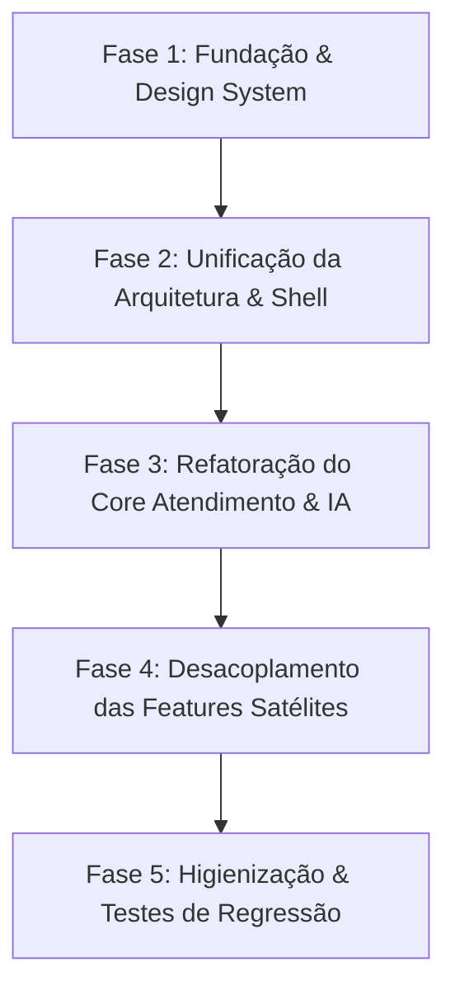

# MD01 - Diagnóstico de Arquitetura, Avaliação de Modularidade e Plano Diretor do SIGE

> **Data:** 12 de Outubro de 2026  
> **Participantes:** Winston (Arquiteto de Sistemas) 🏗️, Amelia (Engenheira de Software Sênior) 💻, Sally (Designer de UX/UI) 🎨, John (Product Manager) 📋, Mary (Analista de Negócios) 📊, Israel (Tech Lead / Fundador)  
> **Status:** Deliberado & Aprovado  
> **Local de Execução:** Projeto SIGE (Sistema Integrado de Gestão Empresarial)

---

## 1. Sumário Executivo

O **SIGE** foi concebido com uma premissa nobre e comercialmente atraente: ser um ERP/SaaS modular, revendível para diversos perfis de clientes, no qual cada empresa contrata e visualiza apenas os módulos que fazem sentido para sua operação (`tenant.modulos_ativos`).

No entanto, a implementação técnica atual degenerou em um fenômeno conhecido na engenharia de software como **"Falsa Modularidade" (ou Espaguete Multi-Package)**:
1. **Acoplamento Horizontal Tóxico:** Módulos que deveriam ser independentes dependem diretamente uns dos outros em tempo de compilação (ex: `module_atendimento` importando `module_leads`, `module_gerente_atendimento` dependendo fortemente de 3 outros pacotes e duplicando widgets internos). Se um módulo é removido da base, outros quebram imediatamente ao compilar.
2. **Caos de Dependências e Build:** 10 arquivos `pubspec.yaml` locais mantendo versões desalinhadas de `flutter_riverpod` (2.4.5, 2.4.9, 2.5.1), `provider` misturado com Riverpod, e o aplicativo raiz importando pacotes que não declara diretamente.
3. **Abstrações Fantasmas / Incompletas:** Contratos em `packages/core` como `ServiceRegistry`, `IStockService` e `EventBus` foram criados para desacoplamento, mas ficaram abandonados pelo meio do caminho — nenhum módulo registra serviços e quase nenhum consome os eventos.
4. **Salada de Fruta Visual (Falta de Design System):** Cada pacote desenha suas telas com decisões visuais isoladas (cores hexadecimais soltas, uso pontual de `google_fonts`, componentes de tabela e listas com layouts conflitantes), enquanto a casca do app tenta enfiar páginas inteiras de mapas e chats dentro de um `Card` desktop engessado com borda arredondada de 20px.
5. **Redundância Funcional:** Módulos como `module_kanban` existem de forma genérica, enquanto `module_atendimento` reimplementou seu próprio kanban do zero e `module_gerente_atendimento` criou um terceiro kanban somente leitura.

### A Decisão Estratégica
A bancada de especialistas deliberou **unanimemente**:
- **Eliminar a divisão artificial em 10 packages locais soltos** em favor de uma **Arquitetura Modular Monolítica (Feature-First) e Limpa**, estruturada dentro de `lib/src/features/` com um `lib/src/core/` robusto.
- **Acabar com acoplamentos horizontais**: Nenhum módulo importa outro módulo diretamente. Toda comunicação cruzada fraca é feita via **Inversão de Controle (IoC / Service Registry)** ou **Eventos de Domínio**.
- **Fusão de Módulos Dependentes**: O que não tem razão comercial de existir isolado (ex: `gerente_atendimento`) é fundido no domínio principal (`atendimento`) com controle por permissão/role (RBAC).
- **Criação Imediata do Design System Unificado (SIGE DS)** antes de qualquer reforma de tela, garantindo consistência visual, Dark/Light mode impecável e ergonomia desktop/mobile.

---

## 2. A Mesa Redonda: Discussão dos Especialistas (BMAD Party Mode)

---

### 📋 **John (Product Manager):**
"Israel, vamos começar pelo que realmente importa: **o cliente não compra arquitetura de pastas no seu disco, ele compra valor de negócio.** 

Você disse uma frase crucial: *'sua funcionalidade principal (atendimento 24/7 com IA omnichannel) funcionava perfeitamente'*. Esse é o coração pulsante do SIGE. É o que bota dinheiro na mesa e resolve a dor de cabeça de quem atende WhatsApp, Instagram e Facebook de madrugada.

O que aconteceu depois foi clássico: no afã de vender o sistema para qualquer empresa imaginável, você tentou vender peças de Lego soltas. Mas olha a armadilha: você criou o `module_gerente_atendimento`. Na cabeça do cliente, ele pensa: *'Ué, contratei Atendimento, mas para o meu gerente ver os atendimentos eu preciso comprar OUTRO módulo?'* Isso não é um módulo adicional, Israel, isso é uma tela de permissão do mesmo produto! 

E pior: se o módulo de Atendimento quebra se eu não tiver o de Leads ativado, a promessa de 'escolher os módulos que couberem no seu modelo de negócio' virou uma ilusão. O cliente se sente enganado quando um botão 'Vincular Lead' trava o sistema porque ele não contratou Leads. 

Minha exigência aqui é clareza: o Atendimento com IA é nosso produto Tier 1. Os outros módulos (Estoque, Leads, Mapa) são agregadores de valor. A arquitetura tem que permitir que o Atendimento funcione **redondo** sozinho, e se o cliente comprar Leads ou Estoque, o Atendimento ganhe superpoderes de forma transparente, sem gambiarras!"

---

### 📊 **Mary (Business Analyst):**
"Concordo totalmente com o John, e trago os números e o padrão de mercado para a mesa. Analisando as empresas que contratam soluções como o SIGE:

1. **Segmentação Real de Clientes (Pacotes de Venda vs Módulos Soltos):**  
   Nenhum cliente corporativo compra 'só mapa' ou 'só kanban genérico'. Eles compram **Soluções**:
   - **Plano Starter (Atendimento Inteligente):** Atendimento Omnichannel IA + Gestão Básica de Conversas.
   - **Plano Pro (Comercial & Vendas):** Atendimento + Gestão de Leads/CRM + Métricas Avançadas.
   - **Plano Enterprise (Operação Total):** Atendimento + CRM + Controle de Estoque/Serviços + Mapa de Calor/Roteirização.

2. **O Custo Oculto da 'Falsa Modularidade':**  
   Hoje, o seu custo de manutenção (Time-to-Market de bugs) está altíssimo porque o sistema tem dependências circulares veladas. O `module_atendimento` puxa o `module_leads`, que puxa o `core`, que tenta ser genérico mas tem modelos específicos.
   
3. **Evidência de Acoplamento Fraco vs Forte:**  
   - **Leads no Atendimento:** É um caso clássico de acoplamento fraco opcional. O atendente precisa vincular um lead se o CRM existir; se não existir, ele só precisa do número de telefone e nome da mensagem.  
   - **Gerente de Atendimento:** É acoplamento forte artificial. Ele não tem mercado separado. Um gestor não compra uma ferramenta de gestão de atendimento sem a ferramenta de atendimento.

A proposta de valor só fica escalável e revendível se o faturamento por tenant refletir um produto coeso, onde cada funcionalidade contratada se pluga sem risco de quebrar a compilação do aplicativo principal."

---

### 🏗️ **Winston (System Architect):**
"Excelente. Agora vamos colocar a planta baixa dessa casa no quadro branco. Israel, você caiu na armadilha mais sedutora do ecossistema Flutter: achar que transformar pastas em pacotes locais (`packages/nome_do_modulo`) com `pubspec.yaml` próprios automaticamente confere arquitetura modular ao sistema.

Não confere. Na verdade, criou o pior dos mundos:
1. **Você não tem micro-frontends independentes:** No final do dia, seu `pubspec.yaml` raiz compila TODOS os 10 pacotes juntos em um único binário (`.apk`, `.exe` ou bundle web). O que decide o que aparece é um `List<String> modulosPermitidos` vindo do Firestore no `HomePage`.
2. **Você tem os custos de um monorepo multi-package sem as ferramentas dele:** Você não está usando Melos para gerenciar versões sincronizadas, então cada `pubspec.yaml` tem versões defasadas de plugins fundamentais (`flutter_riverpod` 2.4 vs 2.5).
3. **Violou o Princípio da Inversão de Dependências (DIP):** O pacote `module_gerente_atendimento` importa diretamente arquivos internos de UI de `module_atendimento` (`import 'package:module_atendimento/widgets/atendimento_avatar.dart';`). Se alguém mexer numa vírgula do widget no módulo de atendimento, quebra o gerente.
4. **Arquitetura de 'Cemitério de Boas Intenções':** Alguém (provavelmente você em um momento lúcido) criou o `ServiceRegistry` e o `EventBus` em `packages/core/lib/src/contracts/service_registry.dart`. Essa era a ideia certa! Mas ela ficou pela metade. Você criou a interface `IStockService`, mas o `module_estoque` nem sabe que essa interface existe!

**Qual é a minha recomendação arquitetural?**
Temos dois caminhos viáveis:
- **Caminho A (Monorepo Limpo com Melos e Pacotes Isolados):** Manter pacotes, mas proibir 100% de dependência horizontal. `module_A` NUNCA importa `module_B`. Ambos só importam `core`. Toda comunicação é via interfaces/contratos e EventBus.
- **Caminho B (Modular Monolith / Feature-First):** Consolidar o código na pasta `lib/src/features/` do app principal, mantendo a separação estrita por domínios (`features/atendimento`, `features/leads`, `features/estoque`, etc.) e um `core/` compartilhado.

**Meu parecer:** O **Caminho B (Modular Monolith - Feature-First)** é ordens de magnitude superior para a realidade do SIGE hoje. Reduz drasticamente a complexidade de compilação, elimina o inferno de `flutter pub get` em 10 pastas, unifica o gerenciamento de estado (Riverpod puro) e permite que a gente refatore as telas e o Design System sem atrito. A modularidade por cliente continua existindo 100% através de **Feature Flags / Permissões dinâmicas do Tenant**."

---

### 💻 **Amelia (Senior Software Engineer):**
"Assino embaixo do Winston, e vou trazer os diagnósticos cirúrgicos da base de código que encontrei agora mesmo na varredura:

1. **`lib/main.dart` vs `pubspec.yaml`:**
   - No `pubspec.yaml` raiz está declarado `provider: ^6.1.5+1`.
   - No `lib/main.dart`, linha 3: `import 'package:flutter_riverpod/flutter_riverpod.dart';` e `runApp(const ProviderScope(child: MyApp()));`.
   - No `module_auth`, temos `ChangeNotifierProvider<AuthService>`.
   - Essa mistura de Provider com Riverpod é uma bomba relógio de vazamento de memória e inconsistência de ciclo de vida.

2. **Código Duplicado & Zumbi:**
   - `packages/module_kanban`: tem um Kanban genérico em Firestore.
   - `packages/module_atendimento`: tem outro Kanban próprio (`atendimento_board_model.dart`, `atendimento_column.dart`).
   - `packages/module_gerente_atendimento`: tem um terceiro Kanban em `readonly_kanban/`.
   - Três motores de arrastar card, três modelos de coluna, três lógicas de persistência! Isso é pesadelo de manutenção.
   
3. **Módulo 'Basic Dashboard' Fantasma (`packages/module_basic_dashboard`):**
   - Um arquivo de 1.095 linhas (`atendimento_dashboard_screen.dart`) com métricas 100% *hardcoded* de WhatsApp, TikTok e Instagram, sem consumir nenhum dado do Firestore!
   - Importa `google_fonts: ^6.1.0` pontualmente e quebra a estilização de todo o resto.

4. **Acoplamento em Tempo de Compilação:**
   - Olhem o arquivo `packages/module_atendimento/lib/widgets/add_atendimento_card_dialog.dart:5`:
     ```dart
     import 'package:module_leads/module_leads.dart';
     // ...
     final leadsAsync = ref.watch(leadsProvider(widget.tenantId));
     ```
     Se o tenant não contratou Leads, esse código ainda assim tenta rodar ou depende do pacote estar compilado no projeto!

Se migrarmos para **Feature-First**:
- Temos **um único** `pubspec.yaml`.
- Usamos Riverpod 2.6+ moderno com `Notifier` / `AsyncNotifier`.
- Criamos um contrato `ILeadLookupProvider` em `core`. Se a feature `leads` estiver habilitada para o tenant, o autocomplete de leads é injetado. Se não estiver, o Atendimento renderiza campos manuais simples. Zero quebra de compilação!"

---

### 🎨 **Sally (UX Designer):**
"Gente, agora segurem na minha mão, porque o que eu vi nessa interface precisa de um resgate de emergência. A expressão do Israel foi perfeita: *'uma tremenda salada de fruta feia e sem persistência visual'*.

Vejam o cenário atual:
1. **A 'Caixa de Sapato' do Desktop (`lib/src/shell/home_page/home_page.dart:268`):**
   - No desktop, a aplicação pega o módulo ativo e coloca dentro de um `Card` com padding `fromLTRB(0, 24, 24, 24)`, elevação 4 e `borderRadius: 20`.
   - O que acontece quando você joga uma tela de Chat de Atendimento ou o `MapScreen` dentro de um Card arredondado com margem fixa? O chat fica cortado, com barras de rolagem duplas, e o mapa perde a sensação imersiva de dashboard profissional!
2. **A Bipolaridade da Navegação:**
   - No mobile, usamos o `GNav` (GoogleNavBar) flutuante com pílula arredondada (`borderRadius: 32`).
   - No desktop, usamos o `Drawer` do Material clássico com `UserAccountsDrawerHeader` azulzão antigo dos anos 2014.
   - As duas coisas parecem pertencer a sistemas completamente diferentes criados por programadores que nunca se falaram!
3. **Inconsistência de Tipografia e Cores:**
   - `lib/src/core/theme/app_theme.dart` define cores Material 3 com Índigo (`0xFF3F51B5`) e Verde (`0xFF4CAF50`).
   - O `login_screen.dart` usa um gradiente roxo hardcoded (`0xFF673AB7`).
   - O `module_basic_dashboard` força `GoogleFonts.inter()` e `GoogleFonts.poppins()` no meio do código.
   - O `module_atendimento` usa cores diretas nos botões de prioridade e balões de chat.

**O que precisamos fazer:**
Não adianta refatorar código se a sensação ao usar o sistema for amadora. Precisamos de:
- **Design System do SIGE (Tokens Centrais):** Paleta semântica corporativa, tipografia única e escalável, espaçamentos padronizados (4, 8, 12, 16, 24, 32px), raios de borda padronizados.
- **Shell de Aplicação Profissional:** Uma barra lateral (Sidebar) retrátil e fluida para Desktop/Tablet e uma barra inferior ergonômica para Mobile. O conteúdo principal precisa ter liberdade de ocupar a tela inteira quando for uma ferramenta de trabalho (como o Atendimento e o Mapa), ou ficar em container contido quando for um formulário ou tabela.
- **Componentes Atômicos de UI:** `SigeButton`, `SigeCard`, `SigeBadge`, `SigeTextField`, `SigeDialog`. Cada módulo consome EXCLUSIVAMENTE esses componentes!"

---

## 3. Parecer Técnico Consolidado

Após a análise detalhada das dores levantadas pelo Israel e da inspeção do código-fonte:

```
                                    ESTADO ATUAL (FALSA MODULARIDADE)
   [ App Shell ]
        |
        +---> packages/core (Contratos não utilizados / EventBus vazio)
        +---> packages/module_auth (ChangeNotifier)
        +---> packages/module_atendimento ------(Acoplamento Rígido)-----> packages/module_leads
        +---> packages/module_gerente_atend. --(Acoplamento Rígido)-----> packages/module_admin_empresa
        |                                   \--(Acoplamento Rígido)-----> packages/module_atendimento
        +---> packages/module_kanban (Isolado, duplicado no Atendimento)
        +---> packages/module_estoque (Isolado, não implementa IStockService)
        +---> packages/module_map (Ouve eventos que ninguém dispara)
        +---> packages/module_basic_dashboard (Mock estático de 1000 linhas)
```

### O Diagnóstico Definitivo
1. **A modularidade atual em pacotes físicos do Flutter fracassou** porque foi estruturada como pacotes autônomos no papel, mas com acoplamento rígido de dependências circulares na prática.
2. **A manutenção de 10 `pubspec.yaml` está drenando energia**: A cada novo plugin adicionado, ocorrem conflitos de compilação em cascata.
3. **A separação de Atendimento vs Gerente de Atendimento é um erro de modelagem de domínio**: O gerente precisa de visibilidade analítica e supervisão das filas do próprio Atendimento, não de um clone de telas com Kanban somente leitura.
4. **O sistema precisa de um Design System unificado** que dite as regras de UI para todas as telas do sistema.

### A Arquitetura Alvo: Modular Monolith (Feature-First) + Clean Ports

```
                                      ARQUITETURA PROPOSTA (SIGE UNIFICADO)
 ┌─────────────────────────────────────────────────────────────────────────────────────────────┐
 │                                      lib/src/core                                           │
 │  ┌───────────────────────┐  ┌────────────────────────┐  ┌────────────────────────────────┐  │
 │  │     Design System     │  │   Service Registry     │  │          Event Bus             │  │
 │  │ (Tokens, Theme, Comp) │  │      (IoC / Ports)     │  │   (Notificações e Eventos)     │  │
 │  └───────────────────────┘  └────────────────────────┘  └────────────────────────────────┘  │
 └──────────────────────────────────────────┬──────────────────────────────────────────────────┘
                                            │ Dependência Unidirecional (Features dependem do Core)
 ┌──────────────────────────────────────────┴──────────────────────────────────────────────────┐
 │                                    lib/src/features                                         │
 │                                                                                             │
 │  ┌─────────────────────────────┐  ┌─────────────────────────────┐  ┌─────────────────────┐  │
 │  │        auth & tenant        │  │         atendimento         │  │        leads        │  │
 │  │   (Login, RBAC, Licença)    │  │  (IA 24/7, Omnichannel,     │  │    (CRM, Funil)     │  │
 │  └─────────────────────────────┘  │   Visão Agente + Gerente)   │  └─────────────────────┘  │
 │                                   └──────────────┬──────────────┘                           │
 │                                                  │ (Consulta Opcional via Core Registry)    │
 │  ┌─────────────────────────────┐                 ▼                 ┌─────────────────────┐  │
 │  │           estoque           │    [ ILeadLookupContract ]        │        mapa         │  │
 │  │   (Produtos, Inventário)    │                                   │ (Geo, IBGE, Raio)   │  │
 │  └─────────────────────────────┘                                   └─────────────────────┘  │
 └─────────────────────────────────────────────────────────────────────────────────────────────┘
                                            │
 ┌──────────────────────────────────────────▼──────────────────────────────────────────────────┐
 │                                      lib/src/shell                                          │
 │               Responsive Cockpit (Sidebar Desktop / BottomNav Mobile + TopBar)              │
 │                  Controle Dinâmico de Exibição via Tenant Entitlements                      │
 └─────────────────────────────────────────────────────────────────────────────────────────────┘
```

---

## 4. Respostas Diretas às Dúvidas do Fundador

### 1. "Manteremos a arquitetura do sistema em packages?"
**Resposta:** **NÃO.**  
Recomendamos unificar os pacotes dentro da pasta estruturada `lib/src/features/` em uma arquitetura **Modular Monolith (Feature-First)**.  
*Por quê?*
- Reduz a complexidade de 10 `pubspec.yaml` para **1 único `pubspec.yaml`**.
- Acaba de vez com versões de bibliotecas desiguais (Riverpod, Firebase, etc.).
- Permite refatorar, renomear e aplicar o Design System em todo o sistema de uma só vez, com autocomplete perfeito da IDE e sem ficar recompilando pacotes locais.
- **Você não perde a modularidade de negócio**: A ativação/desativação de módulos para cada empresa cliente continuará sendo controlada dinamicamente pelo banco (`tenant.modulos_ativos`). A diferença é que o seu código será limpo, robusto e fácil de manter.

### 2. "Continuaremos com funcionalidades que possuem conexão entre módulos diferentes?"
**Resposta:** **SIM para conexões lógicas, mas NÃO para acoplamentos rígidos de código.**  
Adotaremos duas regras universais:
1. **Regra de Ouro: Proibição de Importação Cruzada entre Features (`Zero Cross-Feature Imports`):**  
   O arquivo `features/atendimento` JAMAIS importará nada de `features/leads`.
2. **Inversão de Controle via Contratos (Portas e Adaptadores):**  
   - Se o Atendimento quer vincular um Lead, o Atendimento consome uma interface abstrata definida no `core`: `ILeadLookupProvider`.
   - Se a feature `leads` estiver instalada e ativa no tenant, ela registra sua implementação no `ServiceRegistry`. O Atendimento encontra a implementação e exibe a busca inteligente de Leads.
   - Se a empresa NÃO contratou o módulo de Leads, o `ServiceRegistry` retorna nulo e o Atendimento exibe apenas um campo de texto comum para o nome do contato, sem quebrar absolutamente nada!
3. **Fusão de Módulos Inseparáveis:**  
   `module_gerente_atendimento` deixará de ser um módulo separado. Ele será incorporado diretamente em `features/atendimento`, exibindo a visão de supervisão/gerência caso o usuário logado tenha cargo (`role`) de Gerente ou Administrador.

---

## 5. Plano de Implementação da Refatoração (Passo a Passo)

A execução será dividida em **5 Fases bem definidas e sequenciais**:



### Fase 1: Fundação & Design System Unificado (SIGE DS)
- [ ] Criar `lib/src/core/theme/` com suporte refinado a tokens de cor (Light & Dark mode com contrastes WCAG AAA), tipografia escalável e espaçamentos.
- [ ] Criar biblioteca de componentes atômicos em `lib/src/core/widgets/`:
  - `SigeCard`: container padronizado com elevação e bordas consistentes.
  - `SigeButton`: botões com estados de loading, ícones e variações primária/secundária/perigo.
  - `SigeTextField`: inputs com validação integrada e estilo alinhado.
  - `SigeBadge` & `SigeTag`: tags de status (aberto, pendente, fechado, prioridades).
  - `SigeDialog`: janelas modais padronizadas.
- [ ] Implementar o `ServiceRegistry` e `EventBus` ativos e tipados em `lib/src/core/contracts/`.

### Fase 2: Unificação da Estrutura & Shell Responsivo
- [ ] Migrar a árvore de arquivos para o padrão `Feature-First` dentro de `lib/src/features/`:
  - `auth` (autenticação, perfil, tenant)
  - `atendimento` (atendimento omnichannel, chat, filas, IA)
  - `leads` (CRM, funil)
  - `estoque` (produtos, inventário)
  - `kanban` (motor unificado de cartões/colunas)
  - `admin_empresa` (gestão de funcionários, horários de funcionamento)
  - `mapa` (geolocalização e malhas)
- [ ] Refatorar o Shell (`lib/src/shell/`):
  - Criar o `SigeScaffold`: layout moderno que oferece Sidebar colapsável no desktop e BottomNav adaptativo no mobile.
  - O conteúdo de cada módulo não ficará mais preso num Card minúsculo; terá área de trabalho total com cabeçalho de ações contextual.

### Fase 3: Refatoração do Atendimento (O Coração do SIGE)
- [ ] Integrar as funcionalidades do `module_gerente_atendimento` dentro de `features/atendimento`:
  - Visão do Operador/Atendente: Kanban de conversas, chat com áudio/vídeo, envio de mensagens e interação com bot IA.
  - Visão do Gerente/Admin: Filtro por atendente, métricas em tempo real de tempo de resposta, histórico e intervenção silenciosa no chat.
- [ ] Desacoplar o Kanban do Atendimento usando um motor de colunas consistente.
- [ ] Substituir o import direto de `module_leads` pelo contrato `ILeadLookupProvider`.

### Fase 4: Desacoplamento e Reforma dos Módulos Satélites
- [ ] **Leads:** Padronizar tabela e formulários com o novo Design System; registrar a implementação do `ILeadLookupProvider` no `ServiceRegistry`.
- [ ] **Dashboard:** Eliminar o mock de 1.000 linhas com dados estáticos do TikTok; conectar as métricas reais aos eventos e contadores do Firestore.
- [ ] **Estoque:** Fazer o módulo implementar de verdade a interface `IStockService` para dar baixa em produtos vendidos pelo atendimento.
- [ ] **Mapa:** Conectar o mapa para ouvir eventos de novos leads (`NewLeadEvent`) emitidos de verdade pela feature de Leads.

### Fase 5: Limpeza Geral & Verificação
- [ ] Limpar dependências obsoletas do `pubspec.yaml` raiz (remover mistura de `provider` e alinhar versão do Riverpod).
- [ ] Remover a pasta legada `old_app_components` e o script solto `debug_mesh.dart`.
- [ ] Executar `flutter analyze` e garantir zero erros de compilação e avisos críticos de lint.
- [ ] Validar o fluxo de ponta a ponta: Login -> Carregamento de Módulos por Tenant -> Atendimento -> Troca de Módulos -> Logout.

---

## 6. Próximos Passos Imediatos

Com a aprovação deste parecer, os agentes estão prontos para agir:
1. **Winston & Amelia:** Iniciar a estruturação do `core` e preparação das pastas `lib/src/features`.
2. **Sally:** Desenvolver os componentes e o novo `AppTheme` / Design System.
3. **John & Mary:** Validar a matriz de permissões e os contratos de interface entre Atendimento e Leads.

---
*Documento gerado e arquivado para o ciclo de refatoração do SIGE.*
