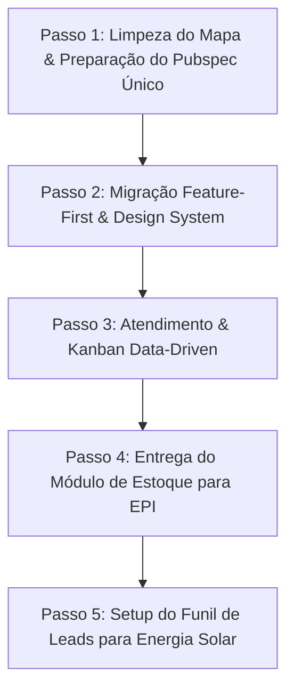

# MD02 - Estratégia de Adaptabilidade Multi-Tenant, Decisão Arquitetural (Feature-First) e Atendimento aos Primeiros Clientes (EPIs e Energia Solar)

> **Data:** 12 de Outubro de 2026  
> **Participantes:** Winston (Arquiteto de Sistemas) 🏗️, Amelia (Engenheira de Software Sênior) 💻, Sally (Designer de UX/UI) 🎨, John (Product Manager) 📋, Mary (Analista de Negócios) 📊, Israel (Tech Lead / Fundador)  
> **Referência:** Complemento direto ao [MD01 - Diagnóstico de Arquitetura e Decisão Estratégica](file:///Users/handersonlima/Desktop/sige/bmad_mds/md01_diagnostico_arquitetura_e_direcionamento.md)  
> **Status:** Deliberado & Aprovado

---

## 1. Sumário Executivo & O Cenário Real de Negócio

O SIGE atinge um ponto de inflexão crítico: **temos tração comercial real.**
1. **Cliente 1 (Já Pagou!):** Empresa do segmento de **EPIs (Equipamentos de Proteção Individual)** — comércio B2B/B2C, venda de produtos físicos com estoque, numeração/tamanhos, reposição recorrente e agilidade comercial no WhatsApp.
2. **Cliente 2 (Em Negociação Avançada):** Empresa de **Energia Solar** — vendas consultivas de alto ticket, ciclo longo (lead -> qualificação técnica com fatura de luz -> proposta -> financiamento bancário -> contrato e vistoria).
3. **Módulo de Mapa (`module_map`):** Formalmente descartado do escopo ativo. Nenhuma das duas empresas precisa de renderização de malhas do IBGE ou desenho de polígonos geoespaciais no momento.
4. **Definição de White Label vs Multi-Tenant:** O sistema é uma plataforma **Multi-Tenant corporativa**. Não criaremos infraestrutura pesada de White Label (domínios dinâmicos, temas isolados por CSS injection). A alteração de logotipo e cor primária é estritamente uma **cortesia profissional cosmética**, aplicada dinamicamente via `ColorScheme.fromSeed` e `Image.network` no login e na barra de navegação.

### O Dilema em Pauta
Como entregar uma solução sob medida para ambas as empresas, utilizando **a mesma base de código unificada**, sem recair na salada de frutas de pacotes (`packages/`) e garantindo manutenibilidade máxima?

A bancada de especialistas deliberou sobre:
1. **Duelo de Arquitetura:** Por que **Feature-First** vence **Layer-First** (`models/`, `services/`, `pages/`) por goleada para sistemas adaptáveis.
2. **Modelagem de Domínio Flexível:** Como o Atendimento Omnichannel com IA e o Kanban se moldam para vender luvas e capacetes pela manhã, e usinas solares de R$ 50.000 à tarde.
3. **Plano de Execução:** O passo a passo para colocar a empresa de EPIs em produção imediatamente e fechar o contrato com a empresa de Energia Solar com uma demonstração impecável.

---

## 2. A Mesa Redonda: Discussão dos Especialistas (BMAD Party Mode)

---

### 📋 **John (Product Manager):**
"Israel, você acabou de nos dar o melhor presente que um time de produto pode receber: **dois clientes reais com dores nítidas e complementares.** 

Olhem para esses dois perfis:
- A **Empresa de EPIs** vive de transação rápida. O cliente chama no WhatsApp: *'Tem bota tamanho 42 com bico de composite e CA válido?'*. O vendedor precisa ver se tem no estoque, o bot com IA precisa consultar a tabela de produtos e fechar a cotação rápido. O funil deles é: `Novo Atendimento -> Cotação -> Pedido Emitido -> Faturamento -> Concluído`.
- A **Empresa de Energia Solar** vive de venda consultiva e qualificação de oportunidade. Ninguém compra painel solar por impulso. O bot de IA precisa perguntar no WhatsApp: *'Qual o valor médio da sua conta de luz?'*, *'O imóvel é próprio ou alugado?'*, *'Poderia me enviar uma foto ou PDF da fatura?'*. O funil deles é: `Novo Lead -> Qualificado -> Vistoria/Dimensionamento -> Proposta Enviada -> Financiamento -> Fechado`.

Percebem? **O motor é exatamente o mesmo: Atendimento 24/7 com IA Omnichannel + Gestão Visual por Colunas.** O que muda são os *metadados* e os *módulos satélites*:
- EPI precisa de: **Atendimento + Catálogo/Estoque**.
- Solar precisa de: **Atendimento + CRM/Leads Consultivo**.

E jogar o Mapa fora foi a melhor decisão do dia. Menos uma distração técnica que consumia pacotes de GPS, malhas do IBGE e não resolvia o problema de nenhum cliente pagante."

---

### 📊 **Mary (Business Analyst):**
"Do ponto de vista estratégico e financeiro, essa divisão é um modelo clássico de **SaaS Verticalizado por Configuração**.

1. **A Empresa de EPIs já pagou:** Esse é o nosso compromisso número um de entrega. Se eles pagaram, eles esperam ver a operação deles rodando rápido. Eles não querem saber de 'módulos complexos de CRM com histórico bancário'; eles querem atender rápido no balcão digital e não vender produto sem estoque.
2. **A Empresa de Energia Solar em negociação:** Para fechar essa venda, o Israel não precisa programar um sistema novo. Ele só precisa mostrar para o diretor da empresa de energia solar um ambiente de demonstração onde o bot pergunta sobre kWh e a coluna do Kanban diz *'Vistoria Técnica'*. Isso causa o efeito 'Uau! Esse sistema foi feito para mim!'.
3. **Branding como Cortesia Comercial:**  
   Excelente posicionamento, Israel! White Label pleno traz custos exorbitantes de infraestrutura e suporte. Manter o produto como **SIGE (Powered by Marandu)** com o logo da EPI ou da Solar no topo dá ao cliente sensação de personalização sem gerar custos de manutenção técnica para você.
4. **Matriz de Empacotamento Comercial:**
   - **Plano Comércio & Varejo (EPI):** Atendimento IA + Estoque/Catálogo + Gestão de Pedidos.
   - **Plano Serviços & Projetos (Solar):** Atendimento IA + Qualificação de Leads + Funil de Vendas Consultivas."

---

### 🏗️ **Winston (System Architect):**
"Agora vamos ao cerne técnico da pergunta do Israel:  
*'É melhor uma arquitetura Feature-First ou Models, Services e Pages (Layer-First)?'*

Vou ser direto e taxativo: **Layer-First em um ERP modular é uma receita infalível para o caos.**

Deixem-me explicar por quê:
Se você organiza por camadas (`lib/models/`, `lib/services/`, `lib/pages/`):
- Daqui a 3 meses você terá 40 arquivos dentro de `lib/models/`: `produto_model.dart`, `lead_model.dart`, `fatura_solar_model.dart`, `epi_model.dart`, `chat_model.dart`...
- Quando você precisar mexer no Estoque para o cliente de EPI, terá que abrir 5 diretórios diferentes na árvore do projeto.
- O pior de tudo: **a fronteira de domínio é invisível.** Fica impossível saber onde termina o Atendimento e onde começa o Lead, porque tudo se mistura no mesmo caldeirão de serviços.

Com **Feature-First (`lib/src/features/`)**:
```
lib/src/
  ├── core/               # Design System, Contratos, EventBus, Registry
  └── features/
      ├── auth/           # Login, Tenant, Perfil
      ├── atendimento/    # Chat Omnichannel, IA, Kanban Unificado
      ├── estoque/        # Produtos, Itens, Estoque (ativo para EPI)
      ├── leads/          # Funil CRM, Dados Consultivos (ativo para Solar)
      └── admin_empresa/  # Funcionários, Horários, Configs
```

**Por que Feature-First é perfeita para a EPI e a Solar?**
1. **Alta Coesão e Baixo Acoplamento:** A pasta `estoque` contém seus próprios modelos, serviços e telas. A pasta `leads` contém os seus.
2. **Ativação Dinâmica Limpa:** A casca do app (`Shell`) apenas consulta `tenant.modulos_ativos`. Se contiver `'estoque'`, renderiza o menu de Estoque; se contiver `'leads'`, renderiza o menu de Leads.
3. **Isolamento de Erros:** Um bug na tela de inventário de EPIs jamais quebrará o carregamento da lista de leads da empresa de energia solar.
4. **Sem Pacotes Separados:** Continua sendo um único projeto Flutter, um único `pubspec.yaml`, sem o inferno de versões desalinhadas."

---

### 💻 **Amelia (Senior Software Engineer):**
"Winston matou a charada arquitetural. Agora vou descer para o código e mostrar **como vamos programar essa adaptabilidade sem gambiarras**:

1. **Adeus Definitivo ao `packages/module_map`:**
   - Já podemos remover a dependência de `flutter_map`, `latlong2`, `geolocator` e o script `debug_mesh.dart` do projeto. Isso enxuga o bundle web e mobile imediatamente e corta dependências que estavam pesando a inicialização.

2. **O Segredo: Kanban Unificado e Data-Driven no Firestore:**
   - Chega dos três Kanbans (`module_kanban`, `module_atendimento` e `readonly_kanban`).
   - O Kanban deve viver dentro de `lib/src/features/atendimento/`.
   - As colunas **NÃO são fixas em código**. Elas vêm do documento do Tenant ou de uma subcoleção `tenant/{tenantId}/kanban_colunas`:
     - Para a EPI: `['Novos Clientes', 'Em Cotação', 'Aguardando Pagamento', 'Despachado']`
     - Para a Solar: `['Qualificação IA', 'Vistoria Agendada', 'Proposta Entregue', 'Financiamento Aprovado', 'Instalação']`
   - O mesmo widget `KanbanBoard` renderiza as colunas de qualquer empresa dinamicamente!

3. **Metadados Flexíveis no Atendimento/Lead (`custom_fields`):**
   - No Firestore, dentro do objeto de atendimento ou lead, incluímos um mapa flexível:
     ```dart
     final Map<String, dynamic> metadata;
     ```
   - No cliente de EPI, esse mapa guarda: `{'tamanho_calcado': '42', 'quantidade': 10}`.
   - No cliente de Solar, esse mapa guarda: `{'consumo_kwh': 850, 'valor_fatura': 920.50, 'distribuidora': 'Neoenergia'}`.
   - O Flutter renderiza esses campos dinamicamente com um componente genérico `SigeMetadataViewer`.

4. **Branding Leve com Riverpod:**
   ```dart
   final themeProvider = Provider<ThemeData>((ref) {
     final tenant = ref.watch(currentTenantProvider);
     final seedColor = tenant?.corPrimaria != null 
         ? Color(int.parse(tenant!.corPrimaria!.replaceFirst('#', '0xFF'))) 
         : const Color(0xFF3F51B5);
     return AppThemes.buildTheme(seedColor);
   });
   ```
   Zero complicação. Carregou o tenant, o app inteiro adota o tom laranja da EPI ou o tom azul da Solar!"

---

### 🎨 **Sally (UX Designer):**
"Isso é música para os meus ouvidos! Do ponto de vista de experiência e design, atender a essas duas empresas no mesmo sistema é uma oportunidade de ouro para provar a força do nosso **Design System**.

Olhem como a interface vai se comportar:
1. **Identidade Visual por Cortesia (Branding Sob Medida):**
   - **Na tela de login:** O logo do SIGE aparece discreto como tecnologia ('Powered by SIGE'), e o logo do cliente fica em destaque no topo do formulário.
   - **Na Sidebar:** O topo exibe o logo da empresa contratante e a cor primária (o laranja para a EPI, o azul turquesa/amarelo para a Solar) é aplicada nos botões ativos, badges de status e indicadores de foco. O resto do sistema mantém cinzas neutros de alta elegância.
2. **Cockpit Operacional com Foco Total:**
   - O operador da loja de EPI abre o SIGE no computador do balcão e vê: **Atendimento (Chat + Kanban de Pedidos)** e **Estoque**. Limpo, direto, sem menus inúteis.
   - O consultor da empresa de energia solar abre o SIGE no notebook e vê: **Atendimento (Chat + Qualificação)** e **CRM/Leads**. As métricas mostram taxa de conversão de propostas, não quantidade de caixas no depósito!
3. **Fim do Conteúdo Engessado:**
   - Como decidimos no MD01, removemos aquele `Card` de 20px com elevação fixa que sufocava o conteúdo no desktop. O Chat de atendimento agora respira, ocupando a altura total da janela com painel lateral retrátil para ver os dados do cliente e os campos customizados."

---

## 3. Parecer Arquitetural e Decisões Definitivas

```
                                      ARQUITETURA ADAPTÁVEL DO SIGE
                                      (Feature-First Modular Monolith)

 ┌─────────────────────────────────────────────────────────────────────────────────────────────┐
 │                                      lib/src/core/                                          │
 │  ┌───────────────────────┐  ┌────────────────────────┐  ┌────────────────────────────────┐  │
 │  │     Design System     │  │    Theme Generator     │  │       Service Registry         │  │
 │  │ (Tokens, Theme, Comp) │  │   (Dynamic SeedColor)  │  │   (Contratos de Lookup/IoC)    │  │
 │  └───────────────────────┘  └────────────────────────┘  └────────────────────────────────┘  │
 └──────────────────────────────────────────┬──────────────────────────────────────────────────┘
                                            │ Dependência Unidirecional
 ┌──────────────────────────────────────────┴──────────────────────────────────────────────────┐
 │                                    lib/src/features/                                        │
 │                                                                                             │
 │  ┌────────────────────────────────┐  ┌───────────────────────────────────────────────────┐  │
 │  │             auth               │  │                    atendimento                    │  │
 │  │   (Login, Tenant, Branding)    │  │  ┌─────────────────────────────────────────────┐  │  │
 │  └────────────────────────────────┘  │  │ Omnichannel Chat (WhatsApp, Insta, Face)    │  │  │
 │                                      │  │ Motor de IA 24/7 (Prompt configurável)       │  │  │
 │                                      │  │ Kanban Dinâmico (Colunas data-driven)       │  │  │
 │                                      │  │ Supervisão de Gerente (Visão por Atendente) │  │  │
 │                                      │  └─────────────────────────────────────────────┘  │  │
 │                                      └─────────────────────────┬─────────────────────────┘  │
 │                                                                │                            │
 │                                    ┌───────────────────────────┴─────────────────────────┐  │
 │                                    │ (Módulos Satélites Ativados por Tenant)              │  │
 │                                    ▼                                                     ▼  │
 │                       ┌─────────────────────────┐                           ┌────────────┴────────┐
 │                       │         estoque         │                           │        leads        │
 │                       │  (Catálogo, Unidades,   │                           │ (Funil Consultivo,  │
 │                       │   Grade - ATIVO P/ EPI) │                           │  Campos Customiz.   │
 │                       └─────────────────────────┘                           │  ATIVO P/ SOLAR)    │
 │                                                                             └─────────────────────┘
 └─────────────────────────────────────────────────────────────────────────────────────────────┘
                                            │
 ┌──────────────────────────────────────────▼──────────────────────────────────────────────────┐
 │                                      lib/src/shell/                                         │
 │              Shell Adaptativo (Sidebar Desktop / BottomNav Mobile + TopBar com Logo)        │
 │                      Exibe APENAS os módulos do plano contratado da empresa                 │
 └─────────────────────────────────────────────────────────────────────────────────────────────┘
```

### Decisão 1: Arquitetura Feature-First (Aprovada)
- **Eliminação dos 10 packages locais:** Toda a lógica será migrada para `lib/src/features/` em um único projeto Flutter centralizado.
- **Estrutura interna padrão de cada feature:**
  ```
  lib/src/features/<nome_da_feature>/
    ├── data/           # Models, DTOs, Repositories/Services do Firestore
    ├── presentation/   # Telas (Screens), Componentes específicos, State Notifiers (Riverpod)
    └── domain/         # Entidades de negócio e regras de validação (quando necessário)
  ```

### Decisão 2: Descarte do Módulo de Mapa
- O diretório `packages/module_map` e as dependências geoespaciais são descontinuadas imediatamente. O SIGE foca 100% em **Atendimento, Conversão e Gestão**.

### Decisão 3: Configuração do Tenant no Firestore
Cada tenant dita como o sistema se comporta através de um único documento de configuração:

```json
{
  "tenant_id": "tenant_epi_01",
  "nome_fantasia": "EPI Forte Equipamentos",
  "segmento": "comercio",
  "branding": {
    "logo_url": "https://storage.../logo_epi.png",
    "cor_primaria": "#F57C00"
  },
  "modulos_ativos": [
    "atendimento",
    "estoque",
    "admin_empresa"
  ],
  "ia_config": {
    "system_prompt": "Você é a assistente virtual da EPI Forte. Forneça cotações rápidas de luvas, capacetes, botas e óculos com CA.",
    "catalogo_ativo": true
  },
  "kanban_config": {
    "colunas": [
      {"id": "c1", "titulo": "Novas Mensagens", "cor": "#3B82F6"},
      {"id": "c2", "titulo": "Em Cotação", "cor": "#F59E0B"},
      {"id": "c3", "titulo": "Pedido Fechado", "cor": "#10B981"},
      {"id": "c4", "titulo": "Entregue/Concluído", "cor": "#6B7280"}
    ]
  }
}
```

```json
{
  "tenant_id": "tenant_solar_02",
  "nome_fantasia": "Solarium Engenharia Solar",
  "segmento": "servicos_alto_ticket",
  "branding": {
    "logo_url": "https://storage.../logo_solar.png",
    "cor_primaria": "#0288D1"
  },
  "modulos_ativos": [
    "atendimento",
    "leads",
    "admin_empresa"
  ],
  "ia_config": {
    "system_prompt": "Você é o consultor de energia solar da Solarium. Colete o consumo médio em kWh ou valor da conta e solicite a foto da fatura.",
    "catalogo_ativo": false
  },
  "kanban_config": {
    "colunas": [
      {"id": "s1", "titulo": "Lead Recebido", "cor": "#3B82F6"},
      {"id": "s2", "titulo": "Qualificado (Conta de Luz)", "cor": "#8B5CF6"},
      {"id": "s3", "titulo": "Proposta em Elaboração", "cor": "#F59E0B"},
      {"id": "s4", "titulo": "Financiamento Bancário", "cor": "#EC4899"},
      {"id": "s5", "titulo": "Contrato Assinado", "cor": "#10B981"}
    ]
  }
}
```

---

## 4. Plano de Implementação Prático para Atender as 2 Empresas

A execução priorizará colocar a **Empresa de EPIs em operação** e deixar a **Empresa de Energia Solar pronta para fechamento de contrato**.



### Passo 1: Limpeza Imediata e Unificação do `pubspec.yaml`
- [ ] Desativar/Remover `module_map` da lista de dependências e limpar o script `debug_mesh.dart`.
- [ ] Consolidar todas as dependências necessárias no `pubspec.yaml` raiz (Riverpod 2.6+, Firestore, FirebaseAuth, LucideIcons, Intl).
- [ ] Eliminar as dependências cruzadas entre pacotes locais.

### Passo 2: Estruturação das Pastas `lib/src/features/` & Design System
- [ ] Criar a estrutura física:
  - `lib/src/core/theme/` (com suporte a cor dinâmica por tenant).
  - `lib/src/core/widgets/` (`SigeButton`, `SigeCard`, `SigeTextField`, `SigeBadge`, `SigeDialog`).
  - `lib/src/features/auth/`
  - `lib/src/features/atendimento/`
  - `lib/src/features/estoque/`
  - `lib/src/features/leads/`
  - `lib/src/features/admin_empresa/`
- [ ] Implementar a casca responsiva (`lib/src/shell/`) com a barra de navegação exibindo dinamicamente apenas os módulos do `tenant.modulos_ativos`.

### Passo 3: Atendimento Omnichannel + Kanban Dinâmico
- [ ] Unificar os 3 Kanbans existentes em um único motor reutilizável dentro de `features/atendimento`.
- [ ] Fazer as colunas do Kanban e as opções de status serem carregadas do documento do Tenant (`kanban_config.colunas`).
- [ ] Incluir suporte a `custom_fields` no card de atendimento (para exibir os dados de EPI ou os dados da conta de energia solar).
- [ ] Integrar a visão de Gerente (supervisão de atendimentos por funcionário) dentro da própria tela de Atendimento com filtro por atendente.

### Passo 4: Operação do Cliente 1 (EPIs)
- [ ] Migrar o `module_estoque` para `lib/src/features/estoque/`, garantindo listagem, cadastro e busca rápida de produtos/EPIs.
- [ ] Cadastrar o Tenant no Firestore com cores, colunas de cotação e módulos ativos: `["atendimento", "estoque", "admin_empresa"]`.
- [ ] Validar o fluxo completo de atendimento e consulta de produto.

### Passo 5: Ambiente de Demonstração e Fechamento do Cliente 2 (Energia Solar)
- [ ] Migrar `module_leads` para `lib/src/features/leads/`, permitindo campos adicionais de proposta comercial (consumo em kWh, concessionária).
- [ ] Criar o Tenant de demonstração da Solar no Firestore com cores azuladas, colunas de qualificação/vistoria técnica e módulos ativos: `["atendimento", "leads", "admin_empresa"]`.
- [ ] Simular um lead entrando pelo WhatsApp, sendo qualificado pelo bot e avançando no funil de vendas consultivas.

---

## 5. Conclusão e Próximo Passo

Com este plano:
1. **Você atende com perfeição o cliente que já pagou (EPIs)** sem fazê-lo esperar por refatorações desnecessárias.
2. **Você ganha um produto pronto para encantar o cliente de Energia Solar**, comprovando que o SIGE se molda ao ciclo comercial consultivo dele.
3. **Você se livra da salada de frutas de 10 pacotes**, trabalhando em uma base de código profissional, limpa, rápida e 100% rastreável com **Feature-First**.

---
*Documento registrado em `bmad_mds/md02 - Adaptabilidade Multitenant e Arquitetura Feature-First.md`.*
