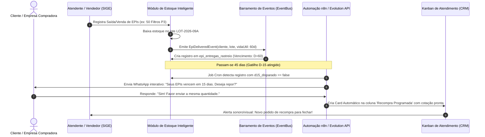

# MD04: Módulo de Estoque Inteligente e Integração com Atendimento
## Gestão Especializada de EPIs, Rastreabilidade de CAs/Lotes, Régua Preventiva Omnichannel e Arquitetura de Revenda SaaS

**Status:** Aprovado por Unanimidade pelo Comitê BMAD  
**Data:** 14 de Outubro de 2026  
**Autores (Comitê BMAD):**
- 📋 **John** (Product Manager)
- 📊 **Mary** (Business Analyst)
- 🏗️ **Winston** (System Architect)
- 🎨 **Sally** (UX/UI Designer)
- 💻 **Amelia** (Lead Software Engineer)

---

## 1. Transcrição do Debate BMAD Party Mode

### Contexto Inicial
A reunião foi convocada a partir da diretriz estratégica da liderança:
1. **Total refatoração do módulo de estoque do SIGE:** A versão legada consistia em uma listagem rudimentar com campos genéricos (`nome`, `sku`, `qtd_atual`, `preco_venda`, `nivel_alerta`), desprovida de inteligência, rastreio temporal ou apelo visual.
2. **Especialização crítica em EPIs (Equipamentos de Proteção Individual):** Necessidade imperativa de gerenciar Certificados de Aprovação (CA do MTE), datas de fabricação, datas de validade de prateleira e vida útil estimada em uso.
3. **Ponte Direta Estoque ↔ Atendimento (CRM Omnichannel):** Criar uma régua de automação de mensagens preventivas via WhatsApp para avisar clientes e colaboradores quando os EPIs estiverem próximos da data limite de substituição (conforme a NR-06), transformando o estoque em um motor ativo de pós-venda e recompra.
4. **Visão de Revenda Comercial (SaaS Multitenant):** Embora o cliente piloto atual utilize um ERP paralelo para almoxarifado, o SIGE é uma plataforma comercializável para o mercado corporativo. O módulo de estoque deve ser autônomo, robusto e de classe mundial (*World-Class*), operando tanto de forma 100% nativa quanto integrado via conectores a sistemas externos.
5. **Design Magnífico ("UAU!"):** Criar uma interface deslumbrante, ergonômica e moderna, com dashboard executivo de inventário, micro-interações refinadas e visualização em grade e alta densidade.

---

### O Debate

📋 **John (Product Manager):**  
"Senhores e senhoras, bem-vindos à nossa mesa redonda. Temos em mãos a maior oportunidade de expansão de produto do SIGE desde a refatoração do atendimento. Nosso usuário nos deu uma missão clara e de altíssimo valor de negócio: refatorar completamente o módulo de estoque. O gatilho imediato é o segmento de EPIs, onde a validade é uma questão jurídica e de segurança humana, mas a nossa visão precisa ir além: o SIGE é um SaaS comercializável. Se amanhã formos vender para uma construtora, para um hospital ou para uma rede distribuidora com 15 filiais, o estoque não pode ser um puxadinho; precisa ser um dos pilares mais brilhantes do sistema. Mary, comece nos dando o panorama regulatório e de mercado sobre por que EPIs exigem um estoque radicalmente diferente do comércio comum."

📊 **Mary (Business Analyst):**  
"Obrigada, John. Quem nunca trabalhou com Segurança do Trabalho acha que gerenciar EPI é como vender caneta. Não é. Estamos falando de normas federais rigorosas, em especial a **NR-06 do Ministério do Trabalho e Emprego (MTE)**. No universo dos EPIs, existem três temporalidades distintas e críticas que uma planilha ou ERP comum simplesmente ignora:
1. **Validade do Certificado de Aprovação (CA):** Todo EPI fabricado no Brasil ou importado precisa de um número de CA emitido pelo MTE. O CA tem data de validade própria (geralmente de 5 anos). Se o CA do fabricante venceu e não foi renovado, aquele lote não pode mais ser faturado nem fornecido, sob pena de multas gravíssimas e responsabilização civil e criminal em caso de acidente de trabalho.
2. **Validade de Fabricação/Prateleira do Produto:** Uma luva de borracha ou um respirador químico tem prazo de validade físico na caixa (ex: 2 a 3 anos a partir da fabricação).
3. **Vida Útil em Uso (Tempo de Troca Obrigatória):** Quando uma empresa entrega um protetor auricular ou um filtro de máscara para um soldador, aquele equipamento tem vida útil pré-determinada (ex: 30 dias para o filtro químico, 6 meses para o capacete). A empresa compradora é obrigada a comprovar a **Ficha de Entrega de EPI** e a substituição periódica.
E aqui está o **pulo do gato de faturamento** que o usuário percebeu: quando a EPI Forte vende 200 filtros químicos para a Construtora Alpha em 1º de março, e a vida útil do filtro é de 45 dias, em 15 de abril esses filtros precisam ser repostos! Se o nosso sistema automatizar essa régua e disparar no WhatsApp do comprador da construtora no dia 30: *'Olá, Roberto! Notamos que os 200 filtros do lote 842 vencem em 15 dias. A NR-06 exige a substituição. Já separamos uma condição especial de recompra com 8% de desconto para faturamento imediato. Deseja aprovar?'* — nós transformamos o almoxarifado em uma **máquina automática de geração de receita**!"

🎨 **Sally (UX/UI Designer):**  
"Gente, eu estou arrepiada com o potencial visual e ergonômico disso! O usuário disse com todas as letras: *'quero um design magnífico, lindo, impactante que o usuário abra e diga UAU!'*. E vamos combinar: a tela atual de estoque parecia um trabalho de faculdade abandonado em 2012. Um `ListView` cinza com caixas brancas sem hierarquia, sem dashboard, sem alma. 
Vou dizer exatamente como vamos transformar isso no estado da arte do design de software corporativo:
1. **Cockpit Executivo de Inventário (Topo da Tela):** Um conjunto de 4 cards em Glassmorphism sutil, com gradientes suaves e ícones semânticos vibrantes:
   - *Patrimônio Estocado (Valor de Custo vs Potencial de Venda);*
   - *Risco de Ruptura (Itens em ponto de pedido / estoque crítico);*
   - *Termômetro de EPIs a Vencer (Lotes vencendo em 15/30/60 dias com anel de progresso visual);*
   - *Radar de CAs do MTE (CAs ativos, em renovação ou vencidos).*
2. **Alternância Dinâmica de Visão (Dual View):** 
   - *Modo Grade de Cards Inteligentes:* Perfeito para tablets ou gerentes que querem ver a foto do produto, badge de CA com status luminoso, barra de progresso do estoque mínimo e chip de categoria com clique rápido.
   - *Modo Tabela Pro de Alta Densidade:* Inspirado nas melhores tabelas financeiras do mercado (Notion/Linear), com ordenação instantânea por coluna, busca em tempo real, seleção múltipla em lote e exportação limpa.
3. **Drawer Lateral Interativo (Ficha 360° do Item):** Ao clicar em um produto, não abrimos um dialog quadrado e tosco. Desliza um Drawer lateral cinematográfico com abas: *'Dados Gerais'*, *'Lotes & CAs'*, *'Histórico de Movimentações'* e a estrela da festa: *'Régua de Atendimento Omnichannel'*, onde o gerente vê quantas notificações automáticas foram disparadas e quantos clientes recompraram a partir daquele EPI!"

🏗️ **Winston (System Architect):**  
"Excelente, Sally. Mas para sustentar esse visual e a inteligência de notificações sem virar um pesadelo de performance e custo no Firestore, precisamos de uma arquitetura impecável. 
Prestem muita atenção em dois pontos fundamentais:
**Primeiro: A dualidade entre o cliente atual e a revenda SaaS.**
O usuário nos alertou: a empresa piloto atual já possui um sistema interno para almoxarifado. Portanto, nossa arquitetura deve operar sob o padrão **Dual-Core Inventory**:
- **Modo Nativo (Full SIGE):** O SIGE gerencia catálogo, lotes, movimentações de entrada/saída, saldo e auditoria de forma 100% autônoma no Firestore.
- **Modo Bridge / Conector (ERP Sync):** Para clientes que já possuem SAP, Bling, Tiny ou TOTVS, o SIGE disponibiliza uma camada de integração via Webhook e API REST. O ERP externo alimenta o estoque, e o SIGE atua como a **Camada de Inteligência e Engajamento Omnichannel**, processando validade de lotes, CAs e disparando para o WhatsApp.
**Segundo: A modelagem de dados no Firestore.**
Não podemos colocar lotes como arrays dentro do documento do produto! Se um item tiver 50 lotes ao longo dos anos, o documento explode em tamanho.
A modelagem correta e escalável é:
- Coleção Principal: `tenant/{tenantId}/estoque_itens/{itemId}` (dados mestres: SKU, nome, categoria, CA, unidade, estoque_minimo, saldo_total);
- Subcoleção de Lotes: `tenant/{tenantId}/estoque_itens/{itemId}/lotes/{loteId}` (lote_codigo, data_fabricacao, data_validade, validade_ca, qtd_lote, status);
- Coleção de Rastreabilidade de Entrega/Venda: `tenant/{tenantId}/epi_entregas_rastreio/{entregaId}` (cliente_id, telefone, item_id, lote_id, data_entrega, data_vencimento_uso, status_notificacao);
- Coleção de Histórico de Movimentações: `tenant/{tenantId}/estoque_movimentacoes/{movId}` (tipo: entrada/saída/ajuste/devolução, responsavel_uid, timestamp)."

💻 **Amelia (Lead Software Engineer):**  
"Assino embaixo da modelagem do Winston. E no código Flutter, podemos estruturar isso com uma separação de camadas limpa e reativa via Riverpod 2.0.
Vejam como vamos construir:
1. **`StockItemModel` Expandido e Tipado:** Suportando tanto atributos gerais de varejo quanto o subconjunto de EPIs (`isEpi`, `caNumero`, `caValidade`, `categoriaEpi`, `diasVidaUtilUso`).
2. **`EventBus` Reativo para Disparo Omnichannel:**
   Quando uma venda ou entrega de EPI é confirmada no módulo de Atendimento, o sistema publica um `SaleConfirmedEvent` ou `EpiDeliveredEvent`. O serviço de estoque decrementa o lote e automaticamente gera o registro de rastreio em `epi_entregas_rastreio`.
3. **Motor de Notificação Preventiva (Cloud Function / n8n Cron):**
   Um webhook diário no `n8n` ou uma rotina agendada no Firebase varre os registros de `epi_entregas_rastreio` que atingiram os gatilhos D-30, D-15 ou D-0. Quando encontra:
   - Dispara a mensagem personalizada de reposição via WhatsApp da Evolution API / Meta Cloud API;
   - Registra a mensagem na conversa do cliente em `atendimento/{tenantId}/conversas`;
   - Se o cliente responder querendo cotar, a IA ou o atendente recebe o card diretamente na coluna de *'Recompra'* do Kanban de Atendimento!
4. **Performance no Frontend:**
   - Implementação de pesquisa com debounce de 300ms;
   - Filtros instantâneos em memória para status de alerta (`Todos`, `Críticos`, `CAs a Vencer`, `EPIs`);
   - Uso de componentes atomizados do nosso Design System (`SigeColors`, `SigeTheme`, `SigeBadge`, `SigeCard`), sem puxar dependências inchadas que possam causar sobrecarga de compilação no DDC Web."

📊 **Mary (Business Analyst):**  
"Amelia, acrescento uma funcionalidade de altíssimo impacto para a Ficha de Entrega de EPI: o **Termo de Responsabilidade Digital**.
A legislação exige que a empresa comprove que o trabalhador recebeu o EPI com CA válido e foi treinado para uso. No SIGE, quando o almoxarife registrar a saída para um colaborador ou a entrega para um cliente, o sistema pode gerar um link seguro ou mensagem no WhatsApp com o recibo de entrega contendo os CAs e a data limite de troca. O cliente ou trabalhador confirma com 1 clique pelo WhatsApp, e a empresa tem 100% de blindagem jurídica e fiscal!"

📋 **John (Product Manager):**  
"Brilhante, Mary! Isso não é apenas um módulo de estoque; é uma **Solução de Conformidade Trabalhista e Automação de Receita Recorrente**.
Nenhum ERP tradicional como Bling ou Tiny oferece isso nativamente. Eles apenas contam caixas. Nós contamos caixas, protegemos a empresa contra processos trabalhistas e geramos novas vendas automáticas no WhatsApp antes que o cliente vá cotar na concorrência.
Comitê, vamos formalizar o consenso:
- **Mary:** Especificação das regras de negócio de EPI, CAs, vidas úteis e réguas de recompra.
- **Winston:** Arquitetura Dual-Core (Nativo + Webhooks de ERP externo), schema do Firestore e Barramento de Eventos.
- **Sally:** Interface visual cinematográfica ('UAU!'), Cockpit Executivo, Dual View e Drawer 360°.
- **Amelia:** Engenharia Flutter com Riverpod, modelos imutáveis, filtros em tempo real e integração n8n/WhatsApp.
Todos de acordo?"

🎨 **Sally:** "De acordo! Vamos deixar esse estoque mais bonito que o painel da Tesla!"  
🏗️ **Winston:** "De acordo. Arquitetura à prova de balas e multitenant estrito."  
📊 **Mary:** "De acordo. Validação regulatória e motor de faturamento garantidos."  
💻 **Amelia:** "De acordo. Plano de implementação pronto para execução."

---

## 2. Parecer Oficial da Equipe e Diretrizes Estratégicas

### 2.1 Posicionamento de Produto: Por que este módulo é o diferencial do SIGE SaaS?
Sistemas ERP genéricos tratam o estoque como um repositório estático e reativo: cadastram-se produtos e descontam-se itens no momento da nota fiscal. 
O **Módulo de Estoque Inteligente do SIGE** adota uma filosofia **Ativa, Preditiva e Orientada a Relacionamento**:
1. **Especialização Vertical em EPIs e Manutenção:** Atende com perfeição o segmento de segurança do trabalho, onde a conformidade legal do Certificado de Aprovação (CA) e a data limite de substituição são determinantes.
2. **Ponte Direta Estoque ↔ CRM Omnichannel:** Cada item movimentado com validade temporal gera um evento programável na régua de comunicação com o cliente/comprador via WhatsApp, aumentando o LTV (*Lifetime Value*) e reduzindo o churn de clientes.
3. **Arquitetura Dual-Core para Revenda:** Permite operar como ERP autônomo (para empresas que desejam centralizar tudo no SIGE) ou como *Intelligence Layer* acoplado a sistemas legados já contratados pelos clientes pilotos.

```
       ┌────────────────────────────────────────────────────────┐
       │                SIGE SAAS - CORE PLATFORM               │
       └───────────────────────────┬────────────────────────────┘
                                   │
              ┌────────────────────┴────────────────────┐
              ▼                                         ▼
   ┌──────────────────────┐                  ┌──────────────────────┐
   │   MODO NATIVO 100%   │                  │     MODO BRIDGE      │
   │ Controle Total SIGE  │                  │  Sync c/ ERP Legado  │
   │ (Firestore Realtime) │                  │ (Webhooks REST/API)  │
   └──────────┬───────────┘                  └──────────┬───────────┘
              │                                         │
              └────────────────────┬────────────────────┘
                                   │
                                   ▼
      ┌────────────────────────────────────────────────────────┐
      │          MOTOR DE INTELIGÊNCIA TEMPORAL (EPI)          │
      │   • Validação Contínua de CAs (Norma NR-06)            │
      │   • Rastreamento de Lotes e Prazos de Prateleira       │
      │   • Cálculo de Vida Útil em Uso por Cliente            │
      └────────────────────────────┬───────────────────────────┘
                                   │
                                   ▼
      ┌────────────────────────────────────────────────────────┐
      │          BARRAMENTO DE EVENTOS & RECONEXÃO CRM         │
      │       (EventBus -> n8n -> WhatsApp Omnichannel)        │
      │   • Régua Preventiva D-30 / D-15 / D-0                 │
      │   • Cards automáticos no Funil de Vendas de Recompra   │
      └────────────────────────────────────────────────────────┘
```

---

## 3. Especificação do Modelo de Dados (Firestore Schema)

O banco de dados é estruturado em subcoleções isoladas por `tenant_id`, garantindo segurança absoluta (*Multi-Tenant Isolation*) e consultas ultrarrápidas sem índices compostos desnecessários.

### 3.1 Documento Mestre do Produto: `tenant/{tenantId}/estoque/{itemId}`
```json
{
  "id": "item_luva_nitrilica_g",
  "tenant_id": "tenant_epi_forte",
  "nome_produto": "Luva Nitrílica Verde Solvex Alta Resistência",
  "sku": "EPI-LUV-001-G",
  "codigo_barras_ean": "7891234567890",
  "categoria": "Proteção para as Mãos",
  "unidade_medida": "PAR",
  "preco_custo": 12.50,
  "preco_venda": 24.90,
  "qtd_atual": 145.0,
  "estoque_minimo": 30.0,
  "nivel_alerta": 40.0,
  "localizacao_almoxarifado": "Corredor B - Prateleira 03",
  "is_epi": true,
  "epi_info": {
    "ca_numero": "38450",
    "ca_validade": "2027-11-20T00:00:00Z",
    "ca_situacao": "VALIDO",
    "normas_atendidas": ["EN 388", "EN 374", "NR-06"],
    "dias_vida_util_uso": 60,
    "tipo_protecao": "Agentes Químicos e Mecânicos",
    "fabricante": "Ansell Healthcare"
  },
  "ativo": true,
  "criado_em": "2026-10-14T09:00:00Z",
  "atualizado_em": "2026-10-14T09:00:00Z"
}
```

### 3.2 Subcoleção de Lotes: `tenant/{tenantId}/estoque/{itemId}/lotes/{loteId}`
```json
{
  "id": "lote_2026_09_A",
  "tenant_id": "tenant_epi_forte",
  "item_id": "item_luva_nitrilica_g",
  "lote_codigo": "LOT-2026-09A",
  "data_fabricacao": "2026-09-01T00:00:00Z",
  "data_validade": "2029-09-01T00:00:00Z",
  "qtd_inicial": 200.0,
  "qtd_atual": 145.0,
  "preco_aquisicao": 12.50,
  "fornecedor": "Distribuidora Nacional de EPIs Ltda",
  "status": "ATIVO"
}
```

### 3.3 Coleção de Rastreio de Entregas & Vencimento de Uso: `tenant/{tenantId}/epi_entregas_rastreio/{entregaId}`
Esta coleção é a ponte entre o estoque e o atendimento. Cada venda ou fornecimento registrado no sistema alimenta este documento.
```json
{
  "id": "rastreio_ent_9821",
  "tenant_id": "tenant_epi_forte",
  "item_id": "item_luva_nitrilica_g",
  "nome_produto": "Luva Nitrílica Verde Solvex Alta Resistência",
  "lote_codigo": "LOT-2026-09A",
  "ca_numero": "38450",
  "cliente_id": "cli_construtora_alpha",
  "cliente_nome": "Construtora Alpha S/A",
  "cliente_telefone": "5511999887766",
  "quantidade_entregue": 50,
  "data_entrega": "2026-10-14T10:00:00Z",
  "data_vencimento_uso": "2026-12-13T10:00:00Z",
  "dias_vida_util": 60,
  "regua_status": {
    "d30_disparado": false,
    "d15_disparado": false,
    "d0_disparado": false
  },
  "status_recompra": "PENDENTE",
  "atendimento_vinculado_id": "card_atend_442"
}
```

### 3.4 Histórico de Movimentações: `tenant/{tenantId}/estoque_movimentacoes/{movId}`
```json
{
  "id": "mov_84729",
  "tenant_id": "tenant_epi_forte",
  "item_id": "item_luva_nitrilica_g",
  "tipo": "SAIDA_VENDA",
  "quantidade": 50.0,
  "saldo_anterior": 195.0,
  "saldo_posterior": 145.0,
  "motivo": "Faturamento Pedido #104 - Construtora Alpha",
  "lote_codigo": "LOT-2026-09A",
  "usuario_uid": "GeKfGtR4DtgwbJca1Q4ZITM8A313",
  "usuario_nome": "Carlos Vendedor",
  "timestamp": "2026-10-14T10:00:00Z"
}
```

---

## 4. O Mecanismo de Conexão: Estoque ↔ Atendimento Omnichannel

### 4.1 A Jornada da Automação de Recompra de EPIs
O grande diferencial do SIGE é transformar um evento passivo de estoque em uma oportunidade ativa de faturamento:



### 4.2 Template das Mensagens da Régua Omnichannel

#### Disparo 1: D-30 (Alerta Preventivo de Planejamento)
> *"Olá, {{cliente_nome}}! Aqui é da {{empresa_nome}}. Identificamos que o fornecimento de {{nome_produto}} (Lote {{lote_codigo}} / CA {{ca_numero}}) completará seu ciclo de vida útil em 30 dias. Conforme a NR-06, a substituição programada garante a segurança da sua equipe e evita paradas na sua operação. Deseja que reservemos o próximo lote para entrega sem frete?"*

#### Disparo 2: D-15 (Cotação Rápida com 1 Toque)
> *"Olá, {{cliente_nome}}! Faltam apenas 15 dias para a expiração do lote de {{nome_produto}}. Para facilitar a rotina do seu departamento de compras, geramos uma proposta expressa idêntica ao seu último pedido com faturamento faturado direto para sua empresa. Clique abaixo para confirmar ou falar com seu consultor:"*
> `[ Botão 1: Confirmar Reposição ]`  
> `[ Botão 2: Falar com Consultor ]`

#### Disparo 3: D-0 (Aviso Crítico de Vencimento e Não-Conformidade)
> *"ATENÇÃO: A validade em uso dos EPIs do pedido #{{pedido_id}} expirou hoje. Manter colaboradores operando com EPIs vencidos infringe a NR-06 e gera passivo trabalhista. Temos estoque à pronta entrega para envio hoje."*

---

## 5. Especificação de UI/UX Magnífica ("UAU!")

Concebida pela **Sally (UX/UI Designer)**, a interface abandona o visual cinza padrão de sistemas legados e adota uma experiência imersiva e de altíssimo nível, perfeitamente integrada aos tokens do `SigeTheme` e `SigeColors`.

### 5.1 Anatomia da Tela Principal (`EstoqueScreen 2.0`)

```
+----------------------------------------------------------------------------------------------------+
| [Ícone Caixa] Estoque Inteligente & EPIs   [Badge NATIVO]  | Pesquisar SKU, Nome ou CA... [Q]      |
| Dashboard em tempo real • Conformidade NR-06 • Automação CRM | [Filtrar] [Grade/Tabela] [+ Novo Item]|
+----------------------------------------------------------------------------------------------------+
|  COCKPIT EXECUTIVO DE INVENTÁRIO (4 Cards Interativos em Glassmorphism)                            |
|  +-------------------+  +-------------------+  +-------------------+  +-------------------+        |
|  | PATRIMÔNIO ATIVO  |  | RUPTURA / ALERTA  |  | EPIs A VENCER     |  | CERTIFICADOS CA   |        |
|  | R$ 284.950,00     |  | 8 Itens Críticos  |  | 14 Lotes < 30 dias|  | 100% Homologados  |        |
|  | Custo: R$ 142.100 |  | Repor urgente     |  | [Ver régua CRM]   |  | 2 CAs a renovar   |        |
|  +-------------------+  +-------------------+  +-------------------+  +-------------------+        |
+----------------------------------------------------------------------------------------------------+
|  BARRA DE SEGMENTOS OPERACIONAIS (Focus Pills):                                                    |
|  [Todos (184)]  [Críticos / Abaixo Mínimo (8)]  [EPIs com CA (62)]  [Vencendo < 30d (14)]          |
+----------------------------------------------------------------------------------------------------+
|  ÁREA DE DADOS (Dual View com Animação Fluida):                                                    |
|                                                                                                    |
|  [Visão Grade: Cards Ricos de Produto]                                                             |
|  +---------------------------------------+  +---------------------------------------+              |
|  | [Badge CA 38450 - VÁLIDO]   [Chip EPI]|  | [Badge CA 12490 - VÁLIDO]   [Chip EPI]|              |
|  | Luva Nitrílica Solvex Ansell - Tam G  |  | Óculos de Proteção Nemesis Antiembaç. |              |
|  | SKU: EPI-LUV-001-G                    |  | SKU: EPI-OCU-004-IN                   |              |
|  | Estoque: 145 PAR  | Mínimo: 30 PAR    |  | Estoque: 12 UN  [ALERTA RUPTURA!]     |              |
|  | [||||||||||||||||||||||||       ] 72% |  | [|||||                        ] 18%   |              |
|  | Preço: R$ 24,90 (Custo: R$ 12,50)     |  | Preço: R$ 18,00 (Custo: R$ 8,20)      |              |
|  | Lote vig.: LOT-2026-09A (Val: Set/29) |  | Lote vig.: LOT-2026-05B (Val: Dez/26) |              |
|  | [Entrada Rápida] [Saída] [Ficha 360°] |  | [Entrada Rápida] [Saída] [Ficha 360°] |              |
|  +---------------------------------------+  +---------------------------------------+              |
+----------------------------------------------------------------------------------------------------+
```

### 5.2 Elementos Visuais Distintivos ("Fator UAU!")
1. **Badges Dinâmicos de Certificado de Aprovação (CA):**
   - **Verde Esmeralda (`#10B981`):** CA Ativo e Homologado no MTE por mais de 180 dias.
   - **Âmbar Pulsante (`#F59E0B`):** CA com vencimento nos próximos 60 dias (alerta o setor de compras para exigir a nova portaria do fabricante).
   - **Vermelho Alerta (`#EF4444`):** CA Vencido. O sistema bloqueia a emissão de venda ou sinaliza com advertência em destaque, protegendo o cliente contra não-conformidade.
2. **Barra de Carga de Estoque com Gradiente:** Uma barra horizontal fluida dentro de cada card indicando visualmente a proximidade do estoque mínimo (Verde -> Amarelo -> Vermelho).
3. **Drawer Lateral 360°:** Desliza da direita da tela com sombra suave e fundo semitransparente, permitindo consultar os lotes físicos, lançar entradas/saídas por leitor de código de barras USB/Câmera e disparar a régua de recompra manualmente se necessário.
4. **Modo Tabela Pro com Densidade Ajustável:** Para almoxarifes experientes que preferem alta densidade de linhas (32px de altura por linha), permitindo conferência massiva de inventário e navegação por teclado (Enter, Setas, Tab).

---

## 6. Plano de Implementação em Ondas (Sprint Roadmap)

O desenvolvimento será executado pelo comitê técnico em quatro ondas sequenciais, sem interrupção dos módulos de atendimento já operacionais.

### Onda 1: Modelos de Dados e Serviços de Estoque Avançado
- **Objetivo:** Estabelecer a camada de entidades, repositórios e serviços no padrão Feature-First.
- **Tarefas:**
  1. Expandir `StockItemModel` com os atributos completos de EPI, CA, dimensões, preços e dados de fabricante.
  2. Criar `StockLoteModel` e subcoleção `estoque/{itemId}/lotes`.
  3. Criar `EpiEntregaRastreioModel` e subcoleção `epi_entregas_rastreio`.
  4. Refatorar `StockService` implementando transações atômicas do Firestore para entradas, saídas com indicação de lote e ajuste de inventário.
  5. Criar novos eventos de domínio em `lib/src/core/events/system_events.dart` (`EpiExpiringEvent`, `StockBelowThresholdEvent`).

### Onda 2: Cockpit Executivo e Interface "UAU!" (Tela Principal)
- **Objetivo:** Transformar visualmente a experiência do usuário com o novo layout de alta performance.
- **Tarefas:**
  1. Implementar o cabeçalho executivo com os 4 KPI Cards interativos (Patrimônio, Ruptura, Validades, CAs).
  2. Implementar a barra de filtros instantâneos (Segmented Filter Pills).
  3. Construir a visualização dual (Cards Ricos com gradientes + Tabela Pro de Alta Densidade com DataTable2).
  4. Adicionar debounce na caixa de pesquisa e suporte a leitura de código de barras/EAN.
  5. Aplicar tipografia corporativa e tokens de cores semânticas do `SigeTheme`.

### Onda 3: Gestão de Lotes, CAs de EPI e Ficha de Entrega
- **Objetivo:** Funcionalidades especializadas de segurança do trabalho e rastreamento de lotes.
- **Tarefas:**
  1. Criar o Drawer lateral 360° para visualização e edição detalhada do produto.
  2. Implementar aba de Lotes com cadastro de data de fabricação, validade e controle de saldo individual por lote (FIFO / PEPS).
  3. Implementar validação visual de CAs e alerta de proximidade de vencimento.
  4. Criar modal de Registro de Saída / Ficha de Entrega de EPI com vínculo de cliente ou colaborador.

### Onda 4: Integração Estoque ↔ Atendimento Omnichannel e Modo Revenda
- **Objetivo:** Fechar o ciclo virtuoso com o módulo de CRM e viabilizar a revenda SaaS multitenant.
- **Tarefas:**
  1. Conectar a confirmação de venda de EPI à criação automática do registro de rastreio em `epi_entregas_rastreio`.
  2. Desenhar e disponibilizar o Webhook REST para ERPs legados atualizarem saldos externamente (Modo Bridge).
  3. Configurar os gatilhos de automação (D-30, D-15, D-0) integrados aos fluxos do `n8n` e WhatsApp da Evolution API.
  4. Testes automatizados de unidade e integração garantindo que nenhuma alteração quebre os tenants existentes.

---

## 7. Conclusão e Próximos Passos
O Comitê BMAD conclui que a reformulação do módulo de estoque transcende uma simples melhoria cosmética: trata-se da criação de uma **plataforma completa de gestão de ativos e conformidade NR-06 com motor de vendas preventivas**. O documento está aprovado para execução imediata pela equipe de desenvolvimento liderada por Amelia.
