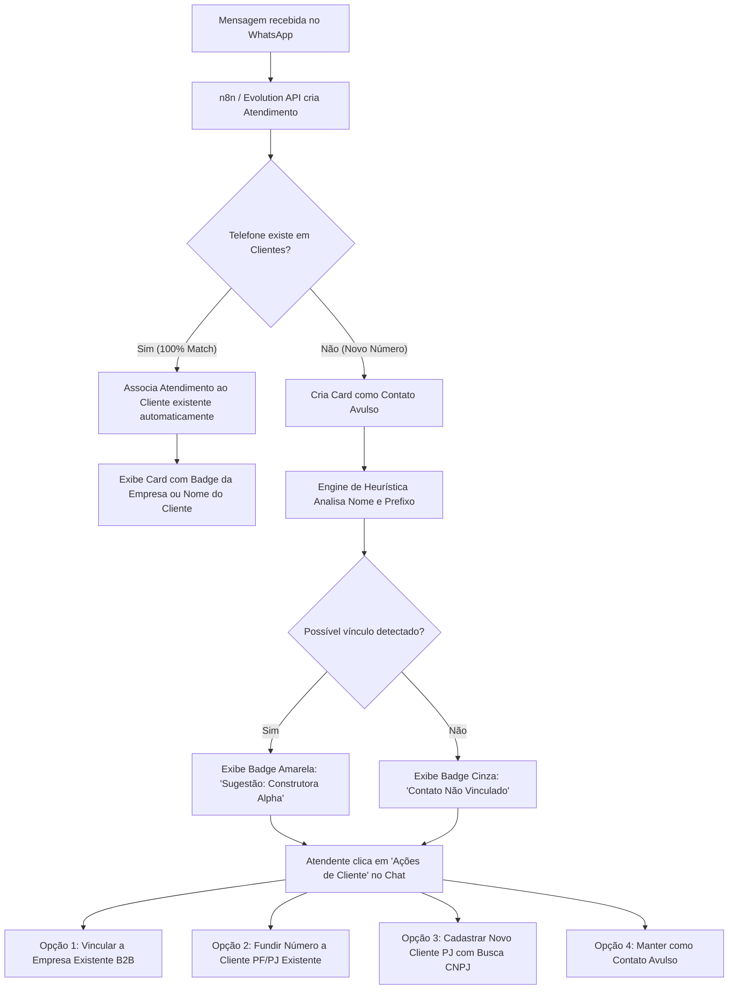
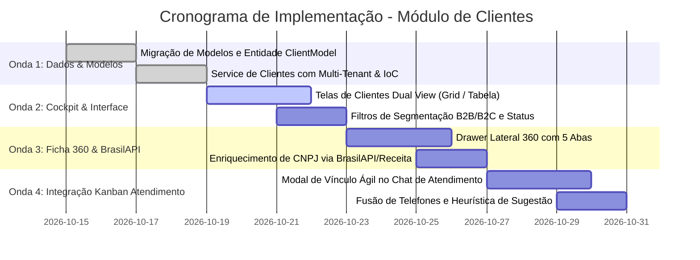

# MD05 — Módulo de Clientes & CRM Unificado (B2B, B2C e Integração Atendimento)

> **Documento de Especificação Técnica, Arquitetura e UX**  
> **Status:** Aprovado em Sessão Colegiada (BMad Party Mode)  
> **Autores:** Mary (Analyst), Winston (Architect), Amelia (Dev), John (PM), Sally (UX Designer)  
> **Versão:** 1.0.0  
> **Data:** 14 de Outubro de 2026  

---

## 1. Visão Geral & Parecer do Colegiado

O antigo módulo de **Leads** foi concebido inicialmente como um cadastro estático e isolado de contatos comerciais. Com o avanço do **SIGE** — que agora conta com um Kanban de Atendimento em tempo real (MD03) e um Módulo de Estoque Inteligente com rastreabilidade de EPIs e régua pós-venda NR-06 (MD04) —, a segregação entre "Lead" e "Cliente" tornou-se um gargalo operacional.

Na rotina real das empresas que utilizam o SIGE (especialmente distribuidoras, revendas e fornecedoras de EPIs e suprimentos):
1. **O cliente raramente é um indivíduo isolado:** Ele é frequentemente o **comprador**, o **mestre de obras**, o **técnico de segurança (TST)** ou o **diretor financeiro** de uma **Pessoa Jurídica (Empresa Cliente)**.
2. **Um novo contato no WhatsApp pode ser:**
   - Um cliente final avulso (B2C);
   - Uma nova empresa solicitando cotação (B2B Lead);
   - Um funcionário novo de uma construtora ou indústria já cliente do SIGE;
   - Um cliente antigo entrando em contato por outro número de telefone ou novo colaborador do setor de suprimentos.
3. **O atendente não pode ser burocratizado:** O fluxo de qualificação não pode exigir que o atendente pare de conversar para preencher 20 campos obrigatórios. A atribuição de vínculo deve ser **ágil, assistida por IA/heurística e com 1 clique**.

### Parecer Unânime do Comitê:
- **Transição de Nomenclatura:** Extinção do termo restritivo "Leads" na interface e no código, adotando o conceito unificado de **"Clientes"** com ciclo de vida dinâmico (`LEAD`, `PROSPECT`, `ATIVO`, `RECORRENTE`, `INATIVO`).
- **Arquitetura Polimórfica (B2B & B2C):** Entidade unificada com capacidade de modelar **Pessoa Jurídica (Empresas)**, **Contatos Vinculados (Funcionários/Compradores)** e **Pessoas Físicas (Autônomos/B2C)**.
- **Detecção Inteligente & Vínculo no Kanban:** Microinterações no card do chat sugerindo vínculos por semelhança de telefone, nome, e-mail ou CNPJ/domínio.
- **Enriquecimento Automático (BrasilAPI/Receita):** Preenchimento automático de Razão Social, Nome Fantasia, CNAE e Endereço ao digitar o CNPJ.
- **Ficha 360° do Cliente:** Histórico consolidado de atendimentos, notas, compras e EPIs vinculados a cada colaborador ou empresa.

---

## 2. Personas & Contribuições da Mesa Redonda

| Agente | Papel | Principal Contribuição no MD05 |
| :--- | :--- | :--- |
| 📋 **John** | Product Manager | Definição da jornada sem atrito para o vendedor/atendente, flexibilidade para vincular ou não no momento do chat, e visão de carteira de clientes. |
| 📊 **Mary** | Business Analyst | Matriz de relacionamento B2B (Empresa Mãe ↔ Múltiplos Contatos/Obras), validação fiscal (CNPJ/CPF, Inscrição Estadual) e cálculo de métricas de LTV/Recorrência. |
| 🏗️ **Winston** | System Architect | Modelo de dados Firestore escalável, índices compostos, resolução de concorrência e eventos desacoplados no `EventBus` (`ClientLinkedEvent`, `PhoneMergedEvent`). |
| 💻 **Amelia** | Senior Dev / Lead | Refatoração estruturada da feature `leads` para `clientes`, contratos no `ServiceRegistry` (`IClientLookupProvider`), caching e consultas com debounce. |
| 🎨 **Sally** | UX/UI Designer | Cockpit Executivo de Clientes, Drawer 360°, Badge de "Possível Vínculo Detectado" no chat, consulta ágil de CNPJ e design tokens `SigeColors`. |

---

## 3. Modelo Conceitual de Dados (Entidade Cliente)

A entidade central no Firestore residirá em:  
`/tenant/{tenantId}/clientes/{clienteId}`

### 3.1. Tipos de Entidade
1. **`PJ` (Pessoa Jurídica / Empresa):** Representa a organização contratante (ex: *Construtora Metrópole Ltda*). Contém CNPJ, faturamento/limite, tabela de preços e lista de colaboradores autorizados a comprar.
2. **`CONTATO_PJ` (Funcionário / Comprador Vinculado):** Indivíduo com WhatsApp próprio que solicita orçamentos ou EPIs em nome da PJ (ex: *Engenheiro Marcos - Comprador de Obras*). Possui chave `empresaId`.
3. **`PF` (Pessoa Física / B2C):** Cliente autônomo ou consumidor direto, sem vínculo corporativo.

### 3.2. Estrutura do Documento (`ClientModel`)

```dart
class ClientModel {
  final String id;
  final String tenantId;
  final String tipo; // 'PJ' | 'PF' | 'CONTATO_PJ'
  final String nome; // Nome Fantasia ou Nome da Pessoa
  final String? razaoSocial; // Para PJ
  final String? documento; // CNPJ ou CPF (limpo, apenas dígitos)
  final String? inscricaoEstadual;
  
  // Comunicação & Multi-Telefones
  final List<String> telefones; // Permite associar 2 ou mais números ao mesmo cliente
  final String telefonePrincipal;
  final List<String> emails;
  
  // Relacionamento B2B
  final String? empresaId; // Preenchido se tipo == 'CONTATO_PJ'
  final String? empresaNome; // Desnormalizado para agilidade visual
  final String? cargo; // Ex: 'Engenheiro de Segurança', 'Almoxarife', 'Comprador'
  final List<String> contatosVinculadosIds; // IDs de contatos vinculados à PJ
  
  // Ciclo de Vida & Classificação
  final String statusCiclo; // 'LEAD', 'ATIVO', 'INATIVO', 'BLOQUEADO'
  final List<String> tags; // ['VIP', 'CONSTRUTORA', 'RECORRENTE', 'TABELA_A']
  final String origem; // 'WHATSAPP', 'INDICACAO', 'BALCAO', 'SITE'
  
  // Dados Financeiros & Parâmetros Comerciais
  final double? limiteCredito;
  final String? tabelaPreco;
  final double ltvTotal; // Soma histórica de vendas fechadas
  final int totalAtendimentos;
  final DateTime? ultimaCompraData;
  
  // Endereço Físico / Entrega
  final ClientAddressModel? endereco;
  
  // Auditoria
  final DateTime criadoEm;
  final DateTime atualizadoEm;
  final String? responsavelUserId;
  final String? observacoesInternas;
}
```

---

## 4. Fluxo Operacional: Do Kanban ao Vínculo Inteligente



### 4.1. Cenários de Atendimento no Dia a Dia

#### Cenário A: Novo Comprador de Cliente Corporativo Existente
- **Situação:** Carlos envia mensagem: *"Olá, sou o novo comprador da Construtora Alpha, preciso de cotação de 50 capacetes"*.
- **Ação do Atendente:**
  1. Clica no botão **"Vincular à Empresa"** no topo da janela de chat.
  2. Digita "Alpha" no autocomplete. O sistema lista a *Construtora Alpha (CNPJ 12.345...)*.
  3. Informa o cargo: *"Comprador"*.
  4. **Resultado Imediato:** O sistema cria o `CONTATO_PJ` para Carlos, salva seu WhatsApp na empresa, atualiza o card do Kanban para *"Construtora Alpha (Carlos)"* e traz o histórico financeiro e tabela de preços da Alpha para a tela!

#### Cenário B: Cliente Antigo com Segundo Número de Telefone
- **Situação:** Dr. Roberto (médico já cliente) chama de um número pessoal novo.
- **Ação do Atendente:**
  1. Clica em **"Atribuir a Cliente Existente"**.
  2. Localiza *"Dr. Roberto Silva"*.
  3. Clica em **"Adicionar este número ao cadastro"**.
  4. **Resultado Imediato:** O novo número é anexado à lista `telefones` do Roberto. Os atendimentos futuros de qualquer um dos dois números abrirão a mesma ficha unificada.

#### Cenário C: Novo Lead B2B Completo
- **Situação:** Primeiro contato de uma empresa desconhecida.
- **Ação do Atendente:**
  1. Clica em **"Novo Cliente (PJ)"**.
  2. O atendente pede o CNPJ e digita `05.123.456/0001-00`.
  3. O SIGE consulta a **BrasilAPI** e em 800ms preenche: Razão Social, Nome Fantasia, Logradouro, Bairro, CEP e Município.
  4. O atendente clica em **"Salvar"**.

---

## 5. Visual & Experiência do Usuário (Sally UX)

### 5.1. Cockpit Executivo de Clientes (Topo da Tela)
Quatro cards com Glassmorphism sutil e contadores reativos:
1. **Total de Clientes & Contatos:** Distribuição gráfica entre PJs cadastradas, funcionários vinculados e PFs.
2. **Clientes Ativos:** Percentual de clientes que compraram ou abriram atendimento nos últimos 60 dias.
3. **Ticket Médio & Volume LTV:** Indicador de valor gerado por cliente corporativo.
4. **Novas Contas (Mês):** Volume de novos clientes qualificados no período.

### 5.2. Visualização Dual: Cards de Perfil vs Tabela de Alta Densidade
- **Modo Grade (Cards Ricos):** Cards com avatar/logo, badges de tipo (`PJ`, `B2B`, `PF`), tags coloridas (`VIP`, `Construtora`), telefone com atalho de WhatsApp direto e total de compras acumuladas.
- **Modo Tabela Pro:** Ideal para supervisores e operadores de televendas, permitindo ordenar por Nome, Documento, Empresa Mãe, Data do Último Contato e LTV.

### 5.3. Ficha 360° do Cliente (Drawer Deslizante)
Um painel lateral deslizante com 5 abas ricas:
- **Aba 1 (Visão Geral & Fiscal):** Razão Social, CNPJ com status na Receita, Inscrição Estadual, tabela de preços, limite de crédito e endereço completo.
- **Aba 2 (Organograma / Pessoas Vinculadas):** Em clientes PJ, lista todos os compradores, engenheiros e almoxarifes com seus respectivos WhatsApps e cargos.
- **Aba 3 (Atendimentos & Histórico de Conversas):** Timeline de todos os chamados abertos no Kanban por qualquer funcionário daquela empresa.
- **Aba 4 (Produtos & EPIs Homologados):** Lista de todos os EPIs e suprimentos já adquiridos, datas de entrega e controle de vencimento NR-06.
- **Aba 5 (Notas Internas & Auditoria):** Observações confidenciais, regras de entrega na obra e restrições de faturamento.

---

## 6. Plano de Implementação em 4 Ondas



### Onda 1 — Fundação de Dados & Serviços Core
1. Criação de `ClientModel`, `ClientAddressModel` e `ClientContactPersonModel` em `lib/src/features/clientes/models/`.
2. Criação do serviço `ClientService` com:
   - CRUD atômico no Firestore (`tenant/{tenantId}/clientes`);
   - Mapeamento e fusão de múltiplos telefones em um cliente existente;
   - Atribuição de contato a empresa mãe (`vincularContatoAEmpresa`);
   - Consulta rápida por telefone (`buscarClientePorTelefone`) com normalização de DDI/DDD.
3. Registro no `ServiceRegistry` implementando `IClientLookupProvider` para retrocompatibilidade com o Kanban de Atendimento.

### Onda 2 — Cockpit Executivo & Navegação
1. Atualização do menu lateral da aplicação ([`sidebar.dart`](file:///Users/handersonlima/Desktop/sige/lib/src/shell/home_page/components/sidebar.dart)) renomeando "Leads" para **"Clientes"** com ícone `Icons.people_alt_rounded`.
2. Implementação do `ClientKpiHeader` com 4 indicadores estratégicos.
3. Criação da barra de filtros por categoria (`TODOS`, `EMPRESAS_PJ`, `CONTATOS_B2B`, `PESSOAS_FISICAS`) e busca global (nome, documento, telefone, cargo).
4. Dual View com `ClientRichCard` e `ClientTableView`.

### Onda 3 — Ficha 360° & Consulta de CNPJ
1. Implementação do `ClientDetailDrawer` com as 5 abas de inteligência de relacionamento.
2. Integração com a **BrasilAPI** (ou ViaCEP / ReceitaWS gratuito) para autopreenchimento de dados fiscais ao digitar CNPJ ou CEP.
3. Gestão visual do organograma da empresa (adicionar novos compradores e ramais diretamente na ficha da PJ).

### Onda 4 — Integração Direta no Atendimento (Chat & Kanban)
1. Inclusão do botão de ação rápida no cabeçalho do Chat de Atendimento:
   - **Vincular à Empresa (B2B)**;
   - **Adicionar Telefone a Cliente Existente**;
   - **Criar Novo Cliente PJ / PF**.
2. Chip de heurística inteligente no Card do Kanban quando o nome do perfil de WhatsApp ou DDD coincidir com clientes cadastrados.
3. Eventos no `EventBus` (`ClientLinkedToCompanyEvent`, `ClientUpdatedEvent`) para sincronização em tempo real entre Atendimento, Estoque e Relatórios.

---

## 7. Diretrizes Técnicas & Boas Práticas

1. **Retrocompatibilidade de Dados:** Os documentos existentes na coleção `leads` do Firestore continuarão legíveis. O `ClientModel.fromFirestore` fará fallback automático de campos legados (`nome`, `telefone`, `origem`), garantindo migração transparente e sem perda de dados.
2. **Índices Firestore:** Criação dos índices compostos necessários no `firestore.indexes.json`:
   - `tenant_id` + `tipo` + `atualizado_em` (desc)
   - `tenant_id` + `telefones` (array-contains)
   - `tenant_id` + `empresa_id`
3. **Consumo de Memória DDC no Web:** Seguir estritamente o uso de `Icons.*_rounded` da biblioteca padrão do Flutter, evitando inclusões de fontes com dezenas de milhares de getters dinâmicos.
4. **Design System:** Respeito absoluto à paleta [`SigeColors`](file:///Users/handersonlima/Desktop/sige/lib/src/core/theme/sige_colors.dart) e tipografia padronizada.
