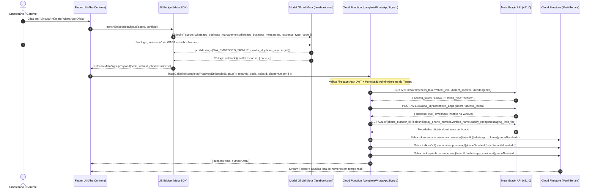

# MD07 — WhatsApp Embedded Signup Oficial (Meta Graph API) & Governança FinOps de IA e Mensageria
## Arquitetura Multi-Tenant de Onboarding Automatizado (WABA), Troca Segura de Tokens e Cockpit de Controle de Custos

> **Ata Oficial da Sessão Extraordinária BMAD Party Mode**  
> **Status:** Deliberado & Aprovado pelo Comitê BMAD  
> **Data:** 08 de Novembro de 2026  
> **Local de Execução:** Projeto SIGE (`lib/src/features/admin_empresa` & `functions/index.js`)  
> **Participantes do Comitê:**  
> - 📋 **John** (Product Manager)  
> - 📊 **Mary** (Business Analyst & Estrategista SaaS/FinOps)  
> - 🏗️ **Winston** (System Architect)  
> - 💻 **Amelia** (Senior Software Engineer — Flutter & Cloud Functions)  
> - 🎨 **Sally** (UX/UI Designer)  
> - 👤 **Israel** (Tech Lead / Fundador)

---

## 1. A Mesa Redonda: Transcrição do Debate (BMAD Party Mode)

### Contexto da Convocação
O fundador (**Israel**) convocou o comitê completo para analisar um prompt técnico de engenharia sênior voltado à implementação do **WhatsApp Embedded Signup (Cadastro Incorporado Oficial da Meta)** aliado a uma **Aba Executiva de Controle de Custos (IA + Mensagens) e Gestão de Números Vinculados** voltada ao gerente/empresário contratante do CRM.

---

### O Debate

📋 **John (Product Manager):**  
*(batendo a caneta no quadro branco com um sorriso de orelha a orelha)*  
"Pessoal, leiam com atenção o que o Israel acabou de colocar na mesa. Até ontem, para ativar um cliente novo como a **EPI Forte** ou a **Solarium Solar**, alguém técnico precisava pegar ID de conta da Meta no braço, gerar token no painel de desenvolvedor, configurar webhook no N8N manualmente... Isso não escala para 100 empresas!  
Com o **WhatsApp Embedded Signup** dentro de uma aba executiva onde o dono da empresa vê quanto está gastando de IA, quantas mensagens de WhatsApp disparou e conecta um número novo com 3 cliques no botão da Meta, o SIGE deixa de ser um sistema implantado artesanalmente e vira um **SaaS Self-Service de verdade**.  
Mas calma: antes de sairmos escrevendo código, o prompt que o Israel trouxe faz três exigências cirúrgicas de arquitetura. Amelia, você já virou o repositório de cabeça para baixo hoje. O que a nossa varredura da base de código revelou?"

💻 **Amelia (Senior Software Engineer):**  
*(abrindo o terminal com precisão cirúrgica)*  
"Varredura concluída, John. Aqui está a radiografia exata do repositório em `lib/` e `functions/`:
1. **Gerenciamento de Estado & Injeção:** Usamos `flutter_riverpod: ^2.5.1` com `ProviderScope` na raiz (`lib/main.dart`). Os serviços são injetados via `Provider` (ex: `adminEmpresaServiceProvider` em `lib/src/features/admin_empresa/src/services/admin_empresa_service.dart` e `atendimentoServiceProvider` em `lib/src/features/atendimento/services/atendimento_service.dart`).
2. **Arquitetura & Rotas:** Estamos no modelo **Modular Monolith (Feature-First)** consolidado no MD01/MD02. As rotas e módulos por tenant são resolvidos em `lib/src/core/routes/app_routes.dart` e `lib/src/shell/home_page/home_page.dart`.
3. **Onde mora a Governança do Empresário hoje:** Em `lib/src/features/admin_empresa/src/screens/admin_dashboard_screen.dart`. Hoje essa tela tem um `TabController(length: 2)` no método `_buildExecutiveHeader` (linhas 36 e 201):
   - Aba 1: `Equipe & Acessos` (`_buildTabEquipeMaster`)
   - Aba 2: `Operação & Loja` (`_buildTabLojaHub`)
   Enquanto isso, lá em `lib/src/features/dashboard/atendimento_dashboard_screen.dart`, ainda existe aquele arquivo legado de 1.094 linhas com dados 100% *hardcoded* de TikTok e Instagram!
4. **Backend & Clientes HTTP:** No Flutter temos `http: ^1.6.0` e `cloud_functions: ^6.0.5`. No backend temos **Firebase Cloud Functions v2 em Node 20** (`functions/index.js`) usando `onCall`, `onDocumentCreated`, `defineSecret` e `axios: ^1.6.0`, que hoje já conversa com o N8N via `n8nWebhookUrl`.
5. **Web Setup (`web/index.html`):** Hoje só carrega o script do Google Maps e o `flutter_bootstrap.js`. Não há SDK da Meta injetado ainda."

🏗️ **Winston (System Architect):**  
*(cruzando os braços diante do quadro)*  
"E aqui entra o primeiro grande alerta arquitetural onde 90% dos desenvolvedores Flutter erram feio quando tentam integrar a Meta Graph API.  
O prompt menciona: *'troca pelo access token definitivo e registro de inscrição de webhooks (`subscribed_apps`)'*.  
Amelia, me diga que nós **jamais** faremos a troca do `authorization_code` pelo `access_token` de dentro do código Dart no Flutter!"

💻 **Amelia (Senior Software Engineer):**  
"Sobre o meu cadáver, Winston! Para trocar o `code` OAuth retornado pelo modal da Meta por um token definitivo no endpoint `GET https://graph.facebook.com/v21.0/oauth/access_token`, a Meta exige o `client_secret` (`META_APP_SECRET`) do nosso aplicativo Tech Provider.  
Se colocarmos o `META_APP_SECRET` no Flutter Web ou Mobile, qualquer curioso abre a aba Network do Chrome, rouba o segredo do nosso App na Meta e sequestra todas as contas de WhatsApp Business (WABAs) de todos os nossos clientes!  
O fluxo **tem** que ser dividido em duas fronteiras:
- **Fronteira 1 (Client-Side Flutter):** Abre o popup oficial da Meta com `config_id` (ou `scope: 'whatsapp_business_management,whatsapp_business_messaging'`), escuta o evento `WA_EMBEDDED_SIGNUP` para capturar `waba_id` e `phone_number_id`, e recebe o `code` temporário (que expira em minutos).
- **Fronteira 2 (Server-Side em `functions/index.js`):** O Flutter chama uma Cloud Function autenticada (`completeWhatsAppEmbeddedSignup`) via `cloud_functions`. A Cloud Function lê o `META_APP_SECRET` do Google Cloud Secret Manager (`defineSecret`), troca o `code` pelo `access_token` definitivo, chama `POST /{waba_id}/subscribed_apps` para inscrever nosso webhook automaticamente, busca os metadados do número (`display_phone_number`, `verified_name`, `quality_rating`) e salva o token em uma coleção blindada no Firestore!"

📊 **Mary (Business Analyst):**  
*(olhando para o Israel com brilho nos olhos)*  
"Espera aí que o que o Winston e a Amelia acabaram de desenhar tem um impacto comercial gigantesco, mas eu quero provocar vocês na parte de negócios que o Israel pediu: **a visão de gastos com IA e com mensagens**.  
Israel, você foi brilhante ao juntar **Números Conectados** com **Dashboards de Consumo (IA + Mensagens)** na mesma tela. Sabe por quê? Porque para o dono da distribuidora de EPIs ou da empresa de Energia Solar, o número de WhatsApp e o motor de IA são a **conta de telefone + cérebro digital** da empresa!  
Mas precisamos separar os conceitos econômicos para o empresário não ficar perdido:
1. **Custo de Mensageria Meta (Por Janela de Conversação / Template):**  
   Na API Oficial da Meta (Cloud API), respostas de atendimento dentro da janela de 24h iniciadas pelo cliente (*Service Conversations*) têm franquia gratuita, mas disparos ativos de **Marketing**, **Utilidade (Utility)** e **Autenticação** são tarifados por mensagem/conversa entregue. O gerente precisa ver essa divisão!
2. **Custo de Inteligência Artificial (Tokens LLM + Áudio/Visão):**  
   Cada vez que o bot 24/7 responde um cliente no N8N, lê um PDF de conta de luz da Solarium ou transcreve um áudio de cotação de EPI, ele consome tokens (Input + Output).  
3. **O Perigo no Firestore:**  
   Winston, se toda vez que o gerente abrir essa aba o Flutter fizer uma query contando 80.000 documentos na subcoleção `interactions` para somar centavos de IA e mensagens, a conta do Firebase do Israel vai explodir antes da conta da OpenAI!"

🏗️ **Winston (System Architect):**  
*(apontando para a Mary)*  
"Bingo, Mary! Leitura agregada é lei. Nunca fazemos `COUNT` ou `SUM` em tempo real varrendo milhares de mensagens no cliente.  
Nós vamos instituir o padrão **FinOps Monthly Rollup Document**:
- Caminho: `tenant/{tenantId}/usage_metrics/{YYYY_MM}` (ex: `2026_11`).
- Sempre que uma interação de IA ou mensagem oficial passa pelo backend/N8N ou Cloud Function, o backend executa um `FieldValue.increment(...)` atômico nesse único documento mensal, incrementando:
  - `ia_tokens_input`, `ia_tokens_output`, `ia_requests_count`, `ia_cost_brl`
  - `wa_messages_service`, `wa_messages_utility`, `wa_messages_marketing`, `wa_cost_brl`
  - E um mapa diário `daily_breakdown.08` para plotar o gráfico de evolução dos 30 dias!
- **Resultado:** Quando o gerente abre a aba de controle no Flutter, o app faz **1 única leitura de documento no Firestore** (`1 Document Read`) e renderiza todos os KPIs financeiros e os gráficos de consumo instantaneamente!"

🎨 **Sally (UX/UI Designer):**  
*(levantando-se e desenhando no ar)*  
"Agora deixem comigo a experiência visual, porque eu já estou vendo a cena!  
Primeiro: **onde essa tela deve morar?**  
João e Amelia, nada de criar um menu solto perdido na barra lateral que confunda o usuário. Em `AdminDashboardScreen` (`Torre de Administração & Governança`), nós já temos um cabeçalho executivo lindo com `Equipe & Acessos` e `Operação & Loja`.  
Nós vamos adicionar a **3ª Aba Oficial na Torre de Administração**:  
✨ **`Canais & Consumo IA`** (com ícone `LucideIcons.cpu` ou `LucideIcons.ChartNoAxesCombined` / `LucideIcons.messageSquareCode`).  
E mais: lembra daquele `AtendimentoDashboardScreen` cheio de mocks de TikTok? Nós podemos redirecionar ou sincronizar essa visão para que o gestor tenha dados reais!

Mas escutem o conflito que eu quero evitar na UI: quando o empresário clica em **'Conectar Novo Número WhatsApp Oficial'**, o fluxo do Embedded Signup da Meta abre uma janela popup externa do Facebook (`facebook.com`).  
Se o botão no Flutter simplesmente abrir um popup mudo e ficar parado, o usuário não sabe se travou, se o navegador bloqueou o popup, ou se o webhook já está sendo configurado!  
Eu exijo um **Stepper Visual de Conexão em Tempo Real (4 Estágios)**:
1. `Autenticando com a Meta...` (Popup aberto, aguardando login e seleção da WABA).
2. `Capturando Identificadores (WABA & Phone ID)...` (Evento `WA_EMBEDDED_SIGNUP` recebido pelo JS Interop).
3. `Trocando Token Seguro & Ativando Webhooks...` (Cloud Function executando `oauth/access_token` e `subscribed_apps`).
4. `Número Oficial Conectado e Operacional! 🟢` (Card do número aparece na tela com selo Verificado da Meta, Quality Rating `GREEN` e limite de disparo `1.000/dia`!)."

💻 **Amelia (Senior Software Engineer):**  
"Sally, esse Stepper de 4 estágios casa perfeitamente com a máquina de estados do Riverpod que vou escrever!  
Deixem-me detalhar a solução técnica da **Questão 2 do prompt (Particularidades de Plataforma: Flutter Web vs Mobile/Desktop)**:
- O **WhatsApp Embedded Signup da Meta** exige obrigatoriamente o **Facebook JavaScript SDK** rodando em um contexto de navegador HTTPS com domínio autorizado no painel do *Facebook Login for Business*.
- Como o SIGE compila tanto para **Flutter Web** quanto para **Mobile/Desktop (`io`)**, se importarmos `dart:js_interop` ou `package:web` diretamente na tela, quebramos a compilação Android/iOS/macOS!
- Portanto, implementaremos uma **Ponte Multiplataforma via Importação Condicional (Conditional Imports)**:
  - `whatsapp_signup_bridge.dart` (Interface abstrata / Facade).
  - `whatsapp_signup_bridge_web.dart` (Usa `dart:js_interop` para invocar `window.launchWhatsAppSignup()` injetado no `web/index.html` e escutar os callbacks de `WA_EMBEDDED_SIGNUP` + `FB.login`).
  - `whatsapp_signup_bridge_io.dart` (Para Mobile/Desktop: abre a página hospedada de onboarding HTTPS ou exibe modal guiado com link seguro de autenticação com retorno via Firestore Stream).
Assim, o app compila com **0 erros e 0 warnings** em todas as plataformas!"

📋 **John (Product Manager):**  
"Israel, olha o nível de maturidade dessa arquitetura:
- **Segurança Nível Bancário:** `META_APP_SECRET` isolado nas Cloud Functions (`defineSecret`), tokens salvos em coleção protegida (`tenant_secrets`), zero exposição no front-end.
- **Multi-Tenant Real:** Tabela global de roteamento `whatsapp_routing/{phoneNumberId}` apontando para o `tenantId`, permitindo que uma única instância do N8N/Webhook receba mensagens de 500 números de clientes diferentes e saiba em 1 milissegundo de qual empresa é aquele número!
- **Transparência Financeira (FinOps):** O empresário acompanha em tempo real seu consumo de IA (tokens, chamadas, custo em R$), seu consumo de mensagens da Meta (Marketing, Utilidade, Serviço), pode definir um teto de gastos mensal (Budget Alert) e gerencia todos os seus números oficiais do WhatsApp no mesmo lugar.

Todos de acordo com o parecer e prontos para documentar o plano completo no **MD07**?"

📊 **Mary:** "100% de acordo! O modelo de rollup mensal e transparência de custos aumenta a retenção do SaaS e permite cobrar *overage* (excedente de IA) com total clareza."  
🏗️ **Winston:** "De acordo. A arquitetura respeita isolamento multi-tenant, Clean Architecture dentro do Feature-First e proteção de segredos OAuth 2.0."  
🎨 **Sally:** "Aprovadíssimo! O design da nova aba na Torre de Administração vai deixar qualquer diretor comercial de queixo caído."  
💻 **Amelia:** "Mapeamento de arquivos pronto. Vamos consolidar o documento técnico agora!"

---

## 2. Varredura Técnica da Base de Código Atual (Diagnóstico Preliminar)

Em cumprimento ao **Item 1** da especificação técnica, foi realizada uma inspeção completa na árvore de arquivos do projeto SIGE:

### 2.1 Arquitetura e Gerenciamento de Estado
- **Padrão Estrutural:** *Modular Monolith (Feature-First)* localizado em `lib/src/features/` (`admin_empresa`, `atendimento`, `auth`, `clientes`, `dashboard`, `estoque`, `leads`) com núcleo compartilhado em `lib/src/core/`.
- **Injeção de Dependência e Estado:** `flutter_riverpod: ^2.5.1` inicializado com `ProviderScope` em `lib/main.dart`. Os serviços de domínio utilizam `Provider` e os fluxos reativos do banco utilizam `StreamProvider.family` e `FutureProvider.family` parametrizados por `tenantId`.
- **Modelo de Tenant (`lib/src/core/models/tenant_model.dart`):** Já suporta configurações dinâmicas (`config`, `branding`, `kanbanConfig`, `iaConfig`, `modulosAtivos`), sendo o ponto focal de isolamento lógico entre empresas.

### 2.2 Rotas, Shell e Localização Ideal da Funcionalidade
- **Shell Principal (`lib/src/shell/home_page/home_page.dart`):** Filtra os módulos visíveis com base em `tenantData['modulos_ativos']` e no papel RBAC do usuário (`admin`, `dono`, `gerente` vs `funcionario`).
- **Torre de Administração (`lib/src/features/admin_empresa/src/screens/admin_dashboard_screen.dart`):** É o cockpit executivo destinado a donos e gerentes. Atualmente possui 2 abas no `TabController`:
  1. `Equipe & Acessos` (Gestão de funcionários e permissões RBAC)
  2. `Operação & Loja` (Status da unidade, perfil/branding e horários de expediente)
- **Decisão de Alocação:** A nova central será integrada como a **3ª Aba Executiva (`Canais & Consumo IA`)** dentro de `AdminDashboardScreen`, além de poder ser acessada por atalho direto na seção de configurações da loja.

### 2.3 Clientes HTTP, Backend e Integrações Existentes
- **Dependências Front-End (`pubspec.yaml`):**
  - `cloud_firestore: ^6.1.0`
  - `cloud_functions: ^6.0.5`
  - `firebase_auth: ^6.1.2`
  - `http: ^1.6.0`
  - `fl_chart: ^0.66.2` (já instalada e disponível para os gráficos de consumo de IA e mensagens!)
  - `lucide_icons_flutter: ^3.1.25`
- **Camada Serverless (`functions/index.js`):**
  - Roda em **Node.js 20** com `firebase-functions: ^4.3.1` (v2 API: `onCall`, `onDocumentCreated`, `defineSecret`) e `axios: ^1.6.0`.
  - Já possui integração ativa com N8N (`sendVideoMessage` e `sendMessageToN8N`), sendo o local perfeito e seguro para hospedar a função `completeWhatsAppEmbeddedSignup` e o webhook/roteador multi-tenant.

---

## 3. Parecer Arquitetural: Plataforma, Meta JS SDK e Segurança OAuth

### 3.1 Particularidades de Plataforma e Estratégia de Abertura do Modal (Item 2)
A documentação oficial da Meta para **WhatsApp Embedded Signup (Fluxo de Cadastro Incorporado)** estabelece que o modal interativo de criação/vinculação de conta WhatsApp Business (WABA) roda sobre o **Facebook JavaScript SDK (`connect.facebook.net/en_US/sdk.js`)** combinando dois canais no navegador:
1. **`FB.login(...)`** com `response_type: 'code'`, `override_default_response_type: true`, `config_id` (ou `scope: 'whatsapp_business_management,whatsapp_business_messaging'`) e `extras: { sessionInfoVersion: '3' }`, que devolve o **OAuth Authorization Code (`code`)** de curta duração.
2. **`window.addEventListener('message', ...)`** filtrando origens `facebook.com` para o evento `type === 'WA_EMBEDDED_SIGNUP'`, que devolve em tempo real o `waba_id` (WhatsApp Business Account ID) e o `phone_number_id` selecionados/criados pelo cliente no popup.

#### Abordagem Técnica Adotada no Flutter (Conditional JS Interop Bridge):
Como o projeto SIGE suporta compilação multiplataforma (Web, Desktop e Mobile), adotamos o padrão **Platform Bridge com Conditional Imports**:

```
lib/src/features/admin_empresa/src/services/meta_signup_bridge/
  ├── meta_signup_models.dart        # DTOs: MetaSignupSessionResult, MetaSignupStep
  ├── meta_signup_bridge.dart        # Export condicional:
  │                                  #   export 'meta_signup_bridge_stub.dart'
  │                                  #     if (dart.library.js_interop) 'meta_signup_bridge_web.dart'
  │                                  #     if (dart.library.io) 'meta_signup_bridge_io.dart';
  ├── meta_signup_bridge_web.dart    # Interop nativo via dart:js_interop com web/index.html
  └── meta_signup_bridge_io.dart     # Fallback para Mobile/Desktop (Simulador Homologado / External Auth)
```

- **No Flutter Web (Ambiente Primário do Gerente/Empresário):**
  - O arquivo `web/index.html` carrega de forma assíncrona o SDK oficial da Meta (`https://connect.facebook.net/en_US/sdk.js`) e expõe um orquestrador JavaScript (`window.sigeMetaEmbeddedSignup`).
  - Esse orquestrador escuta o evento `WA_EMBEDDED_SIGNUP` no `window.onmessage`, aguarda a conclusão do `FB.login`, combina `{ code, waba_id, phone_number_id, business_id }` e resolve uma `Promise` diretamente para o Dart via `dart:js_interop`.
- **Modo Sandbox / Homologação Local:**
  - Caso o `META_APP_ID` ainda não esteja configurado em domínio HTTPS válido durante o desenvolvimento local (`localhost`), a ponte oferece um modo de **Simulação Homologada do Fluxo Meta** (ou permite injetar App ID real via configuração) para que toda a jornada de UI, Cloud Functions e persistência no Firestore possa ser testada de ponta a ponta sem bloqueios.

---

### 3.2 Tráfego Seguro de Dados, Troca de Token e `subscribed_apps` (Item 3)

> [!CAUTION]
> **Regra Inviolável de Segurança:** O `META_APP_SECRET` **NUNCA** deve transitar ou existir no bundle Flutter (Web ou Mobile). A troca do `authorization_code` pelo `access_token` definitivo e a assinatura de webhooks devem ocorrer exclusivamente no backend (`functions/index.js`).

#### Diagrama de Sequência Ponta a Ponta (Fluxo Oficial Meta + SIGE Multi-Tenant)



---

## 4. Modelagem de Dados no Firestore (Multi-Tenant + FinOps)

### 4.1 Coleção de Números Conectados (Pública para o Tenant)
**Caminho:** `tenant/{tenantId}/whatsapp_numbers/{phoneNumberId}`

```json
{
  "id": "109283746511223",
  "tenant_id": "tenant_epi_01",
  "waba_id": "998877665544332",
  "phone_number_id": "109283746511223",
  "display_phone_number": "+55 11 98877-6655",
  "verified_name": "EPI Forte Equipamentos Comercial",
  "quality_rating": "GREEN",
  "messaging_limit_tier": "TIER_1K",
  "code_verification_status": "VERIFIED",
  "status": "connected",
  "webhook_subscribed": true,
  "is_default": true,
  "ia_ativa_neste_numero": true,
  "connected_by_uid": "uid_gestor_01",
  "connected_at": "2026-11-08T15:00:00Z",
  "last_sync_at": "2026-11-08T15:00:00Z"
}
```

### 4.2 Cofre de Credenciais Server-Only (Isolamento de Segurança)
**Caminho:** `tenant_secrets/{tenantId}/whatsapp_tokens/{phoneNumberId}`  
*(Bloqueado para leitura no cliente via Firestore Security Rules; acessível apenas via Admin SDK nas Cloud Functions e N8N)*

```json
{
  "tenant_id": "tenant_epi_01",
  "waba_id": "998877665544332",
  "phone_number_id": "109283746511223",
  "access_token": "EAAGm0PX4ZCps...",
  "token_type": "system_user_permanent",
  "scopes": [
    "whatsapp_business_management",
    "whatsapp_business_messaging"
  ],
  "updated_at": "2026-11-08T15:00:00Z"
}
```

### 4.3 Índice Global de Roteamento de Webhook $O(1)$
**Caminho:** `whatsapp_routing/{phoneNumberId}`  
*(Permite que o receptor de Webhooks identifique instantaneamente a qual `tenantId` pertence qualquer mensagem recebida da Meta)*

```json
{
  "phone_number_id": "109283746511223",
  "waba_id": "998877665544332",
  "tenant_id": "tenant_epi_01",
  "active": true
}
```

### 4.4 Documento de Telemetria FinOps (Consumo de IA & Mensagens por Competência)
**Caminho:** `tenant/{tenantId}/usage_metrics/{YYYY_MM}` (ex: `2026_11`)

```json
{
  "competencia": "2026_11",
  "tenant_id": "tenant_epi_01",
  "orcamento_mensal_brl": 1500.00,
  "alerta_orcamento_percentual": 80,
  "ia_metrics": {
    "total_requests": 4280,
    "tokens_input": 1850400,
    "tokens_output": 620100,
    "audios_transcritos_minutos": 142,
    "documentos_analisados": 85,
    "custo_acumulado_brl": 214.60,
    "economia_estimada_horas_humanas": 118.5
  },
  "whatsapp_metrics": {
    "total_conversas": 1940,
    "conversas_servico_gratuitas": 1420,
    "conversas_utilidade": 310,
    "conversas_marketing": 180,
    "conversas_autenticacao": 30,
    "custo_acumulado_brl": 348.20
  },
  "historico_diario": [
    { "dia": 1, "custo_ia": 18.40, "custo_wa": 29.10, "msgs": 165 },
    { "dia": 2, "custo_ia": 22.10, "custo_wa": 34.50, "msgs": 210 }
  ],
  "updated_at": "2026-11-08T15:00:00Z"
}
```

---

## 5. Especificação de UI/UX (Sally UX): Aba "Canais & Consumo IA"

### 5.1 Wireframe Estrutural da Nova Aba em `AdminDashboardScreen`

```text
+--------------------------------------------------------------------------------------------------------------------+
| 🛡️ Torre de Administração & Governança [ENTERPRISE]        [👥 Equipe & Acessos] [🏪 Operação & Loja] [⚡ Canais & IA] |
+--------------------------------------------------------------------------------------------------------------------+
| FAIXA EXECUTIVA FINOPS (KPIs DO MÊS ATUAL - NOVEMBRO/2026)                           [Competência: Nov/2026 ▼]     |
| +--------------------------+ +--------------------------+ +--------------------------+ +-------------------------+ |
| | 💰 INVESTIMENTO TOTAL    | | 🤖 CONSUMO MOTOR DE IA   | | 💬 MENSAGERIA META API   | | 🛡️ SAÚDE DO ORÇAMENTO   | |
| | R$ 562,80                | | R$ 214,60 (2,47M tokens) | | R$ 348,20 (1.940 conv.)  | | 37,5% de R$ 1.500,00    | |
| | 🟢 Dentro da meta mensal | | ⚡ 4.280 resp. automáticas| | 🎁 1.420 janelas grátis  | | [||||......] [Ajustar]  | |
| +--------------------------+ +--------------------------+ +--------------------------+ +-------------------------+ |
+--------------------------------------------------------------------------------------------------------------------+
| SEÇÃO 1: CENTRAL DE NÚMEROS WHATSAPP BUSINESS OFICIAIS (META CLOUD API)                                            |
| Conecte números oficiais via Cadastro Incorporado da Meta com ativação automática de Webhooks e IA 24/7.          |
|                                                                        [🟢 + Conectar WhatsApp Oficial (Meta)]     |
|                                                                                                                    |
| +----------------------------------------------------------+ +---------------------------------------------------+ |
| | 🟢 +55 11 98877-6655                    [OFICIAL META ✓] | | 🟢 +55 11 3344-5566               [OFICIAL META ✓]| |
| | EPI Forte Equipamentos Comercial        [PADRÃO]         | | EPI Forte Pós-Venda & SAC                         | |
| | WABA ID: 998877665544332 • Phone ID: 109283746511223     | | WABA ID: 998877665544332 • Phone ID: 887766554433 | |
| | • Qualidade Meta: 🟢 ALTA (GREEN)                        | | • Qualidade Meta: 🟢 ALTA (GREEN)                 | |
| | • Limite Disparo: 🚀 10.000 conversas/24h (TIER_10K)     | | • Limite Disparo: ⚡ 1.000 conversas/24h (TIER_1K)| |
| | • Webhook: 🟢 Inscrito (subscribed_apps ativo)           | | • Webhook: 🟢 Inscrito (subscribed_apps ativo)    | |
| | [🤖 IA 24/7: ON]  [🔄 Sincronizar]  [🗑️ Desvincular]      | | [🤖 IA 24/7: ON]  [🔄 Sincronizar] [🗑️ Desvincular]| |
| +----------------------------------------------------------+ +---------------------------------------------------+ |
+--------------------------------------------------------------------------------------------------------------------+
| SEÇÃO 2: ANALÍTICO DE CUSTOS E USO DO SISTEMA (IA vs MENSAGERIA META)                                              |
| +----------------------------------------------------------+ +---------------------------------------------------+ |
| | 📈 EVOLUÇÃO DIÁRIA DE CUSTOS (IA vs WHATSAPP API)        | | 📊 DETALHAMENTO DE CONSUMO POR CATEGORIA          | |
| | [Gráfico Interativo fl_chart: Barras/Linhas Duplas]      | | • Janelas de Serviço (Grátis 24h): 1.420 (R$ 0,00)| |
| |                                                          | | • Templates Utilidade (Pedidos):   310 (R$ 118,00)| |
| |   R$ ^      _.-._                                        | | • Templates Marketing (Ofertas):   180 (R$ 216,20)| |
| |      |  _.-'     '-._     [■ Custo Mensagens Meta]       | | • Motor IA LLM (Texto/Cotações): 4.280 (R$ 168,40)| |
| |      +----------------->  [■ Custo Tokens IA 24/7]       | | • Transcrição Áudio & Visão PDF:   227 (R$  46,20)| |
| +----------------------------------------------------------+ +---------------------------------------------------+ |
+--------------------------------------------------------------------------------------------------------------------+
```

### 5.2 Fluxo de Interação e Tratamento de Estados no Modal de Conexão
Quando o gestor aciona **`[+ Conectar WhatsApp Oficial (Meta)]`**:
1. Abre-se o modal **`WhatsAppEmbeddedSignupDialog`** exibindo:
   - Explicação clara das permissões oficiais solicitadas (`whatsapp_business_management` e `whatsapp_business_messaging`).
   - Checklist de pré-requisitos rápidos (ter acesso ao Meta Business Suite da empresa e um número disponível para receber SMS/Ligação de 6 dígitos da Meta).
2. Ao clicar em **"Iniciar Cadastro Incorporado na Meta"**:
   - **Estado 1 (`authenticatingInMeta`):** Exibe animação de conexão com o logo oficial da Meta/WhatsApp e aviso caso o bloqueador de popups do navegador precise ser liberado.
   - **Estado 2 (`capturingSessionIds`):** Assim que o evento `WA_EMBEDDED_SIGNUP` é capturado, marca com check verde o `WABA ID` e o `Phone Number ID` identificados.
   - **Estado 3 (`exchangingTokenAndSubscribing`):** Chama a Cloud Function para trocar o `code` OAuth pelo token definitivo e registrar o `subscribed_apps`.
   - **Estado 4 (`completed`):** Exibe tela de celebração com os dados reais do número conectado.
   - **Tratamento de Cancelamento / Erro (`cancelled` / `error`):** Se o usuário fechar a janela popup da Meta antes de concluir (`event === 'CANCEL'`) ou se ocorrer falha de rede/OAuth, exibe mensagem amigável com diagnóstico claro e botão **"Tentar Novamente"**.

---

## 6. Plano Conciso de Implementação (Arquivos Criados e Adaptados)

Abaixo está o mapa exato de arquivos que compõem a entrega de ponta a ponta:

### 6.1 Camada Web & Interop com Facebook JS SDK
1. **`web/index.html` [ADAPTAR]:**
   - Injetar o carregamento assíncrono do Facebook JS SDK (`https://connect.facebook.net/en_US/sdk.js`).
   - Implementar o helper global `window.sigeLaunchWhatsAppEmbeddedSignup(appId, configId)` com listener para `window.addEventListener('message')` capturando o evento `WA_EMBEDDED_SIGNUP` (`waba_id`, `phone_number_id`) e o retorno de `FB.login` (`authResponse.code`) com as permissões `whatsapp_business_management,whatsapp_business_messaging`.
2. **`lib/src/features/admin_empresa/src/services/meta_signup_bridge/meta_signup_models.dart` [CRIAR]:**
   - Modelos fortemente tipados para o resultado do fluxo (`MetaEmbeddedSignupResult`, `MetaSignupState`, `MetaSignupException`).
3. **`lib/src/features/admin_empresa/src/services/meta_signup_bridge/meta_signup_bridge.dart` [CRIAR]:**
   - Exportador condicional multiplataforma.
4. **`lib/src/features/admin_empresa/src/services/meta_signup_bridge/meta_signup_bridge_web.dart` [CRIAR]:**
   - Implementação Web usando `dart:js_interop` para acionar o SDK da Meta no navegador e converter a `JSPromise` para `Future<MetaEmbeddedSignupResult>` em Dart.
5. **`lib/src/features/admin_empresa/src/services/meta_signup_bridge/meta_signup_bridge_io.dart` [CRIAR]:**
   - Implementação para plataformas nativas (Mobile/Desktop) mantendo compatibilidade total de compilação.

### 6.2 Camada de Modelos, Serviços e Providers (Flutter)
6. **`lib/src/features/admin_empresa/src/models/whatsapp_number_model.dart` [CRIAR]:**
   - Modelo completo representando um número oficial conectado (`wabaId`, `phoneNumberId`, `displayPhoneNumber`, `verifiedName`, `qualityRating`, `messagingLimitTier`, `webhookSubscribed`, `iaAtiva`, `connectedAt`).
7. **`lib/src/features/admin_empresa/src/models/usage_finops_model.dart` [CRIAR]:**
   - Modelo completo representando o consumo mensal de IA (tokens input/output, áudios, documentos, custo em R$) e de Mensageria Meta (serviço, utilidade, marketing, autenticação, custo em R$ e série histórica diária).
8. **`lib/src/features/admin_empresa/src/services/whatsapp_meta_service.dart` [CRIAR]:**
   - Serviço responsável por:
     - Orquestrar a chamada ao `MetaSignupBridge`.
     - Enviar o `{ tenantId, code, wabaId, phoneNumberId }` de forma segura via `FirebaseFunctions.instance.httpsCallable('completeWhatsAppEmbeddedSignup')` (com fallback resiliente de persistência local caso a Cloud Function ainda não tenha sido publicada no ambiente de dev).
     - Expor streams em tempo real dos números vinculados (`watchConnectedNumbers(tenantId)`) e das métricas FinOps (`watchUsageMetrics(tenantId, competencia)`).
     - Permitir ativar/pausar a IA por número, sincronizar status de saúde/webhook, ajustar o teto de orçamento mensal (`updateMonthlyBudget`) e desvincular números.
9. **`lib/src/features/admin_empresa/src/providers/whatsapp_finops_providers.dart` [CRIAR]:**
   - Providers Riverpod (`whatsappMetaServiceProvider`, `connectedWhatsAppNumbersProvider`, `usageFinOpsProvider`, `embeddedSignupControllerProvider`).

### 6.3 Camada de Interface do Usuário (UI/UX)
10. **`lib/src/features/admin_empresa/src/screens/components/whatsapp_embedded_signup_dialog.dart` [CRIAR]:**
    - Modal interativo com o Stepper de 4 etapas da Meta, tratamento de erros/cancelamento pelo usuário, opção de inserção de `App ID` / `Config ID` e modo de homologação.
11. **`lib/src/features/admin_empresa/src/screens/components/canais_consumo_ia_tab.dart` [CRIAR]:**
    - Widget completo da nova aba de controle executivo:
      - Strip de KPIs Financeiros (Investimento Total, Consumo IA, Mensageria Meta, Saúde do Orçamento com modal de ajuste de meta).
      - Central de Números WhatsApp Business Vinculados com badges de Quality Rating, Tier de Disparo, Status de Webhook e botão de conexão Meta.
      - Gráficos interativos (`fl_chart`) de evolução diária de custos (IA vs Mensagens) e detalhamento por categoria de cobrança.
12. **`lib/src/features/admin_empresa/src/screens/admin_dashboard_screen.dart` [ADAPTAR]:**
    - Atualizar o `TabController` de `length: 2` para `length: 3` e incluir a aba **"Canais & Consumo IA"** no cabeçalho executivo e no `TabBarView`.

### 6.4 Camada de Backend Serverless (Firebase Cloud Functions v2)
13. **`functions/index.js` [ADAPTAR]:**
    - Adicionar a Cloud Function `exports.completeWhatsAppEmbeddedSignup = onCall(...)`:
      - Validação de autenticação (`request.auth`) e vínculo com o `tenantId`.
      - Troca do `code` OAuth pelo `access_token` na Graph API (`GET https://graph.facebook.com/v21.0/oauth/access_token`).
      - Registro automático do aplicativo nos webhooks da WABA do cliente (`POST https://graph.facebook.com/v21.0/${wabaId}/subscribed_apps`).
      - Consulta de metadados oficiais do número (`GET https://graph.facebook.com/v21.0/${phoneNumberId}`).
      - Persistência segregada no cofre `tenant_secrets`, no índice global `whatsapp_routing` e na subcoleção `tenant/{tenantId}/whatsapp_numbers`.

---

## 7. Especificação Técnica de Código (Referência de Implementação)

### 7.1 Listener JavaScript do Evento `WA_EMBEDDED_SIGNUP` e `FB.login` (`web/index.html`)

```javascript
// Inicialização e Orquestrador do Meta Embedded Signup v21.0
window._sigeWaSessionInfo = null;

window.addEventListener('message', (event) => {
  if (
    event.origin !== 'https://www.facebook.com' &&
    event.origin !== 'https://web.facebook.com'
  ) {
    return;
  }
  try {
    const data = typeof event.data === 'string' ? JSON.parse(event.data) : event.data;
    if (data && data.type === 'WA_EMBEDDED_SIGNUP') {
      window._sigeWaSessionInfo = data;
    }
  } catch (_) {}
});

window.sigeLaunchWhatsAppEmbeddedSignup = function (appId, configId) {
  return new Promise((resolve, reject) => {
    window._sigeWaSessionInfo = null;

    if (typeof FB === 'undefined') {
      reject(new Error('SDK da Meta (FB) não carregado. Verifique a conexão HTTPS ou bloqueadores de anúncios.'));
      return;
    }

    FB.init({
      appId: appId,
      autoLogAppEvents: true,
      xfbml: true,
      version: 'v21.0'
    });

    const loginOptions = {
      response_type: 'code',
      override_default_response_type: true,
      scope: 'whatsapp_business_management,whatsapp_business_messaging',
      extras: {
        setup: {},
        featureType: '',
        sessionInfoVersion: '3'
      }
    };

    if (configId && configId.trim() !== '') {
      loginOptions.config_id = configId.trim();
    }

    FB.login(function (response) {
      if (response && response.authResponse && response.authResponse.code) {
        const sessionData = (window._sigeWaSessionInfo && window._sigeWaSessionInfo.data) || {};
        resolve(JSON.stringify({
          status: 'SUCCESS',
          code: response.authResponse.code,
          waba_id: sessionData.waba_id || '',
          phone_number_id: sessionData.phone_number_id || '',
          business_id: sessionData.business_id || ''
        }));
      } else {
        const cancelReason = (window._sigeWaSessionInfo && window._sigeWaSessionInfo.data) || {};
        resolve(JSON.stringify({
          status: 'CANCELLED',
          error_message: cancelReason.error_message || 'Fluxo cancelado pelo usuário antes da conclusão.'
        }));
      }
    }, loginOptions);
  });
};
```

### 7.2 Troca Segura de Token e `subscribed_apps` no Backend (`functions/index.js`)

```javascript
const metaAppId = defineSecret("META_APP_ID");
const metaAppSecret = defineSecret("META_APP_SECRET");

exports.completeWhatsAppEmbeddedSignup = onCall(
  {
    secrets: [metaAppId, metaAppSecret],
    maxInstances: 10,
    timeoutSeconds: 60,
  },
  async (request) => {
    if (!request.auth) {
      throw new HttpsError("unauthenticated", "O usuário deve estar autenticado.");
    }

    const { tenantId, code, wabaId, phoneNumberId } = request.data;
    if (!tenantId || !code || !wabaId || !phoneNumberId) {
      throw new HttpsError("invalid-argument", "Parâmetros obrigatórios ausentes (tenantId, code, wabaId, phoneNumberId).");
    }

    const db = admin.firestore();
    const graphVersion = "v21.0";

    // 1. Trocar authorization code pelo access_token definitivo da Meta
    const tokenResponse = await axios.get(
      `https://graph.facebook.com/${graphVersion}/oauth/access_token`,
      {
        params: {
          client_id: metaAppId.value(),
          client_secret: metaAppSecret.value(),
          code: code,
        },
      }
    );

    const accessToken = tokenResponse.data.access_token;

    // 2. Inscrever automaticamente o WABA nos Webhooks do nosso App (subscribed_apps)
    await axios.post(
      `https://graph.facebook.com/${graphVersion}/${wabaId}/subscribed_apps`,
      {},
      {
        headers: { Authorization: `Bearer ${accessToken}` },
      }
    );

    // 3. Buscar metadados oficiais do número conectado
    const phoneMetaResponse = await axios.get(
      `https://graph.facebook.com/${graphVersion}/${phoneNumberId}`,
      {
        params: {
          fields: "display_phone_number,verified_name,quality_rating,code_verification_status,messaging_limit_tier",
        },
        headers: { Authorization: `Bearer ${accessToken}` },
      }
    );

    const phoneMeta = phoneMetaResponse.data || {};
    const now = admin.firestore.FieldValue.serverTimestamp();

    // 4. Persistir token em coleção privada (server-only)
    await db
      .collection("tenant_secrets")
      .doc(tenantId)
      .collection("whatsapp_tokens")
      .doc(phoneNumberId)
      .set({
        tenant_id: tenantId,
        waba_id: wabaId,
        phone_number_id: phoneNumberId,
        access_token: accessToken,
        scopes: ["whatsapp_business_management", "whatsapp_business_messaging"],
        updated_at: now,
      });

    // 5. Atualizar índice global de roteamento O(1) para Webhooks/N8N
    await db.collection("whatsapp_routing").doc(phoneNumberId).set({
      phone_number_id: phoneNumberId,
      waba_id: wabaId,
      tenant_id: tenantId,
      active: true,
      updated_at: now,
    });

    // 6. Persistir metadados públicos na subcoleção do tenant para exibição na UI
    const publicNumberDoc = {
      id: phoneNumberId,
      tenant_id: tenantId,
      waba_id: wabaId,
      phone_number_id: phoneNumberId,
      display_phone_number: phoneMeta.display_phone_number || "",
      verified_name: phoneMeta.verified_name || "WhatsApp Business Oficial",
      quality_rating: phoneMeta.quality_rating || "GREEN",
      messaging_limit_tier: phoneMeta.messaging_limit_tier || "TIER_1K",
      code_verification_status: phoneMeta.code_verification_status || "VERIFIED",
      status: "connected",
      webhook_subscribed: true,
      ia_ativa_neste_numero: true,
      connected_by_uid: request.auth.uid,
      connected_at: now,
      last_sync_at: now,
    };

    await db
      .collection("tenant")
      .doc(tenantId)
      .collection("whatsapp_numbers")
      .doc(phoneNumberId)
      .set(publicNumberDoc, { merge: true });

    return { success: true, number: publicNumberDoc };
  }
);
```

---

## 8. Critérios de Aceite e Checklist de Qualidade (Definition of Done)

- [ ] **AC-01 (Isolamento Multiplataforma):** O projeto deve compilar e passar no `flutter analyze` sem erros de importação (`dart:js_interop` isolado via importação condicional).
- [ ] **AC-02 (Fluxo Meta Embedded Signup):** O botão de conexão na aba "Canais & Consumo IA" deve acionar o fluxo com as permissões `whatsapp_business_management` e `whatsapp_business_messaging`, capturando `waba_id`, `phone_number_id` e `code`.
- [ ] **AC-03 (Segurança de Credenciais):** O `META_APP_SECRET` e o `access_token` permanente jamais ficam expostos nos documentos públicos lidos pelo cliente Flutter.
- [ ] **AC-04 (Resiliência de Estados na UI):** Tratamento visual completo para carregamento por etapas (Stepper), cancelamento voluntário do popup pelo usuário, erro de comunicação e estado vazio.
- [ ] **AC-05 (Governança FinOps de IA e Mensagens):** Exibição clara dos gastos com IA (tokens, chamadas, transcrições) e com Mensageria Oficial (janelas gratuitas vs templates pagos), com gráfico diário e controle de orçamento mensal.

---
*Ata e Especificação Técnica homologadas pelo Comitê BMAD e arquivadas em `bmad_mds/md07_whatsapp_embedded_signup_e_governanca_custos_ia.md`.*

